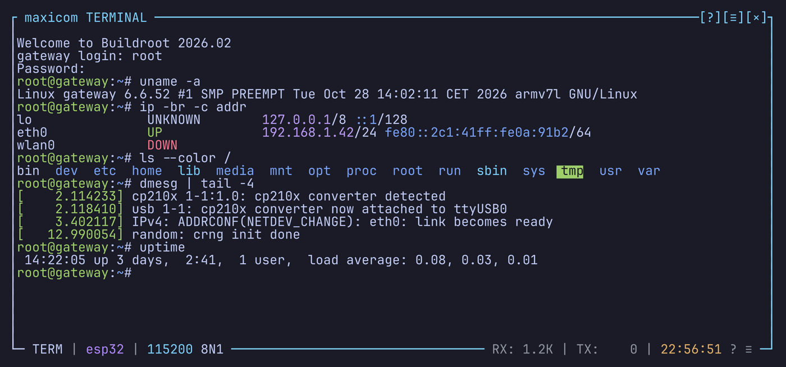

<h1 align="center">
  
</h1>

<p align="center">
  <a href="https://pierre-mollard.github.io/maxicom/"><b>Read the user guide</b></a>
</p>

A serial terminal for the console, in the spirit of minicom, written in Rust.
It opens a serial port or a device over TCP, on Linux, macOS and Windows.



- Two views of the same data: a terminal emulator for shells and full-screen
  programs, and a line mode for logs, with timestamps and an input box
- Scrollback, search, copy mode with vi keys, mouse selection
- A raw side panel with the bytes in hex, octal or binary
- Every session backed up and restored at the next launch; recordings and
  replays
- Saved links and a dialing directory, TCP links (ser2net, ESP32 bridges,
  QEMU), port locks shared with minicom and picocom
- A command line (`send`, `dtr`, `break`, `mash`...), keys bound to command
  lines, triggers that answer boot prompts
- minicom's keys and options: `maxicom -D /dev/ttyUSB0 -b 115200`, then
  `Ctrl-a z` for the help
- Keys, colors and the status bar all configurable

## Install

```bash
cargo install maxicom
```

No system library needed. Per-OS notes (serial port groups, macOS port names,
Windows Terminal, WSL2): [Install](docs/guide/install.md).

## Quick start

```bash
maxicom /dev/ttyUSB0            # COM3 on Windows; 115200 8N1 by default
maxicom /dev/ttyUSB0 -b 9600    # another baud rate
maxicom                         # pick a port in the directory
```

`Ctrl-a` is the prefix: `Ctrl-a ?` lists the keys, `Ctrl-a m` switches
between terminal and line mode, `Ctrl-a q` quits. The ten things you'll do
most: [Quick start](docs/guide/quick-start.md).

## Documentation

The user guide is online at
[pierre-mollard.github.io/maxicom](https://pierre-mollard.github.io/maxicom/).
Its pages, which GitHub also shows:

- [Introduction](docs/guide/introduction.md)
- [Install](docs/guide/install.md)
- [Quick start](docs/guide/quick-start.md)
- [Coming from minicom](docs/guide/coming-from-minicom.md)
- [Popups](docs/guide/popups.md)
- [Links](docs/guide/links.md)
  - [The directory](docs/guide/directory.md)
  - [Saved links](docs/guide/saved-links.md)
  - [TCP links](docs/guide/tcp-links.md)
  - [Port locks](docs/guide/locks.md)
- [Line mode](docs/guide/line-mode.md)
- [Terminal mode](docs/guide/terminal-mode.md)
- [Encoding and newlines](docs/guide/encoding-and-newlines.md)
- [Copy mode and mouse](docs/guide/copy-mode-and-mouse.md)
- [Search](docs/guide/search.md)
- [Raw side panel](docs/guide/raw-side-panel.md)
- [Triggers](docs/guide/triggers.md)
- [Capture](docs/guide/capture.md)
- [Notifications](docs/guide/notifications.md)
- [Command line](docs/guide/command-line.md)
- [Settings](docs/guide/settings.md)
- [Keybindings](docs/guide/keybindings.md)
- [Theme](docs/guide/theme.md)
- [Highlights](docs/guide/highlights.md)
- [Status bar](docs/guide/status-bar.md)
- [Troubleshooting](docs/guide/troubleshooting.md)
- [Messages](docs/guide/messages.md)
- [What maxicom doesn't do](docs/guide/limits.md)

What changed in each version: [CHANGELOG.md](CHANGELOG.md).

Building on maxicom: [CONTRIBUTING.md](CONTRIBUTING.md).
Reporting a security issue: [SECURITY.md](SECURITY.md).

### Author

Pierre Mollard

### License

Licensed under either of [Apache License, Version 2.0](LICENSE-APACHE) or
[MIT license](LICENSE-MIT) at your option.

Unless you explicitly state otherwise, any contribution intentionally submitted
for inclusion in maxicom by you, as defined in the Apache-2.0 license, shall be
dual licensed as above, without any additional terms or conditions.
