<p align="center">
  
</p>

<h1 align="center">maxicom</h1>

<p align="center">
  <b>A serial terminal for the console, in the spirit of minicom, written in Rust.</b>
</p>

<p align="center">
  It opens a serial port or a device over TCP (raw, telnet or RFC 2217): a terminal emulator
  for shells and full-screen programs, a line mode for logs, the raw bytes in hex beside them,
  live plots, and every session backed up. minicom's keys and options work as they are.
  <br><br>
  Highly configurable and modular: keys, colors, highlights, triggers and the status bar, with
  per-device profiles laid on top, all reloaded live without a restart.
</p>

<p align="center">
  <a href="https://github.com/Pierre-Mollard/maxicom/actions/workflows/ci.yml"></a>
  <a href="https://github.com/Pierre-Mollard/maxicom/actions/workflows/docs.yml"></a>
  <a href="https://crates.io/crates/maxicom"></a>
  <a href="https://crates.io/crates/maxicom"></a>
  <a href="https://github.com/Pierre-Mollard/maxicom/releases"></a>
  <br>
  
  
  <a href="#license"></a>
  <a href="https://pierre-mollard.github.io/maxicom/"></a>
</p>

<p align="center">
  <a href="https://pierre-mollard.github.io/maxicom/"><b>User guide</b></a> ·
  <a href="#a-tour">A tour</a> ·
  <a href="#features">Features</a> ·
  <a href="#install">Install</a> ·
  <a href="#quick-start">Quick start</a> ·
  <a href="#documentation">Documentation</a> ·
  <a href="CHANGELOG.md">Changelog</a>
</p>

<p align="center">
  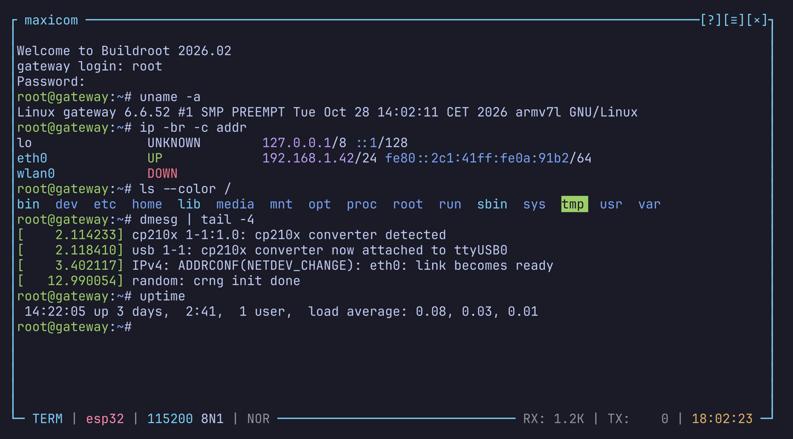
</p>

## A tour

Every screenshot below comes from the [user guide](https://pierre-mollard.github.io/maxicom/), where each feature has its own page.

<table>
  <tr>
    <td width="50%" valign="top">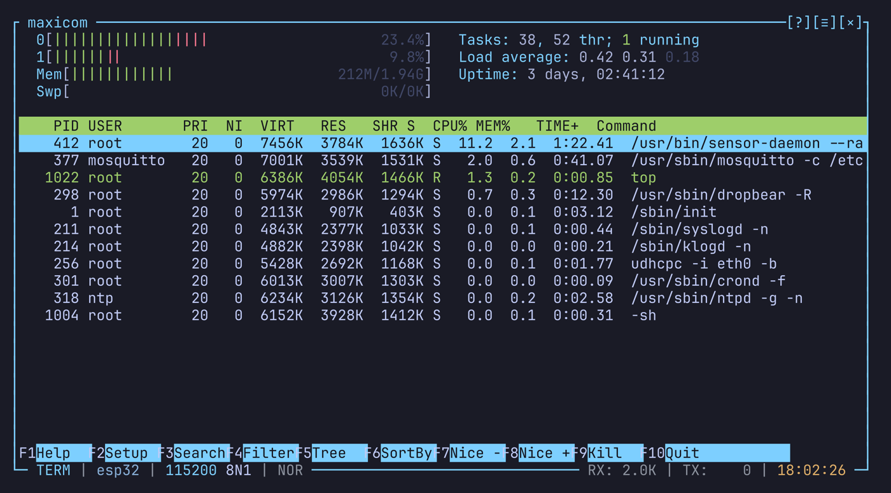<p align="center"><sub><b><a href="docs/guide/terminal-mode.md">Terminal mode</a>.</b> A full terminal emulator for shells and full-screen programs, with its scrollback.</sub></p></td>
    <td width="50%" valign="top">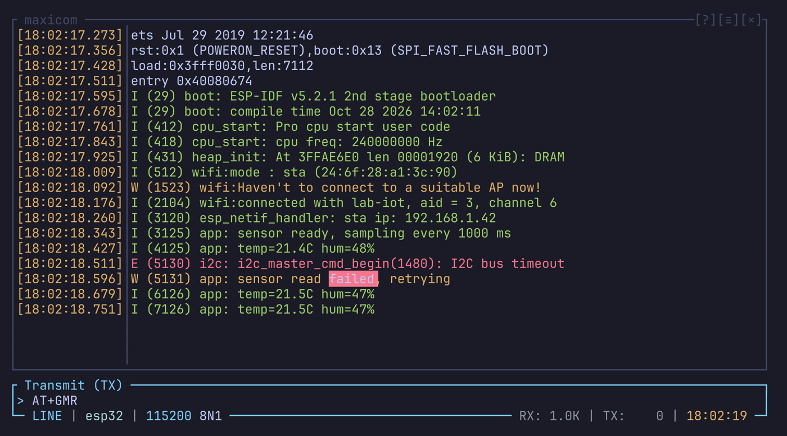<p align="center"><sub><b><a href="docs/guide/line-mode.md">Line mode</a>.</b> For logs: each line timestamped, an input box with its own history, the same data as terminal mode.</sub></p></td>
  </tr>
  <tr>
    <td colspan="2">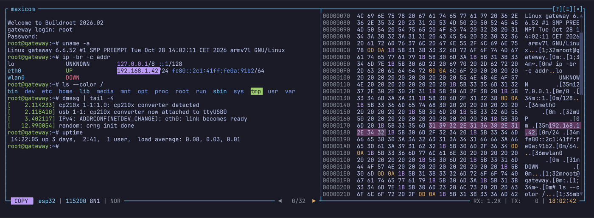<p align="center"><sub><b><a href="docs/guide/raw-side-panel.md">Raw side panel</a>.</b> The bytes in hex, octal or binary beside the text. In terminal mode, select something on the screen and the bytes that drew it light up in the dump.</sub></p></td>
  </tr>
  <tr>
    <td colspan="2">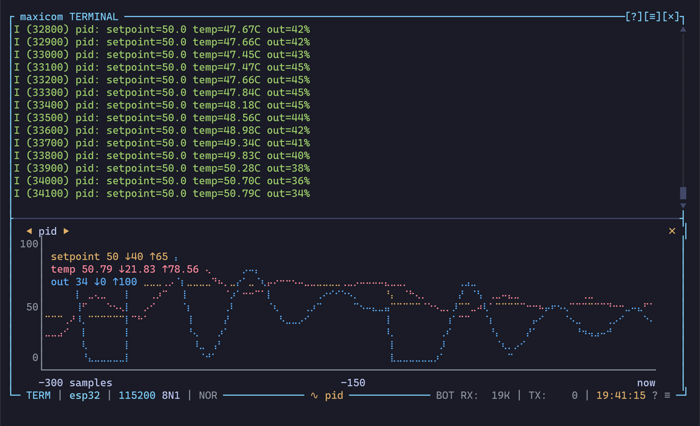<p align="center"><sub><b><a href="docs/guide/plots.md">Plots</a>.</b> The numbers your device prints (<code>temp=23.4</code>, the serial plotter format) charted live under the log.</sub></p></td>
  </tr>
  <tr>
    <td width="50%" valign="top">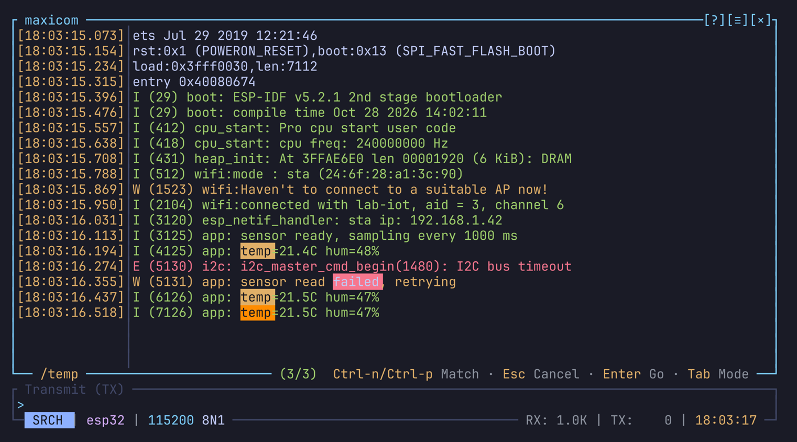<p align="center"><sub><b><a href="docs/guide/search.md">Search</a>.</b> Every match lit, the count in the bar, forward and back through the history.</sub></p></td>
    <td width="50%" valign="top">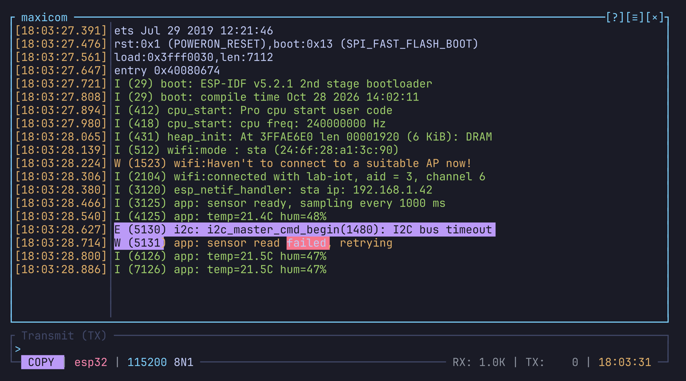<p align="center"><sub><b><a href="docs/guide/copy-mode-and-mouse.md">Copy mode</a>.</b> Move with vi keys, select and copy, or use the mouse.</sub></p></td>
  </tr>
  <tr>
    <td width="50%" valign="top">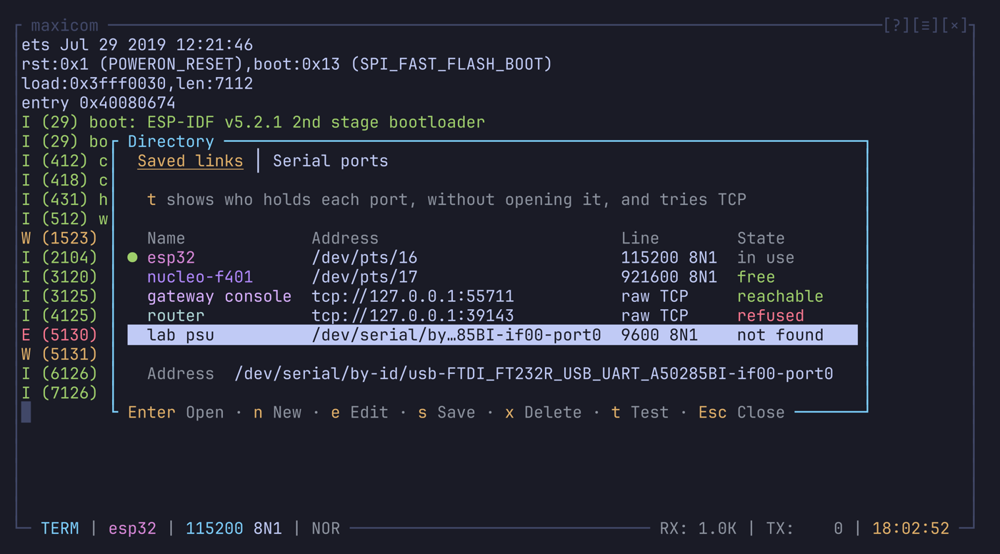<p align="center"><sub><b><a href="docs/guide/directory.md">Directory</a>.</b> Saved links and the system's ports in one table, each one tested: in use, free, reachable.</sub></p></td>
    <td width="50%" valign="top">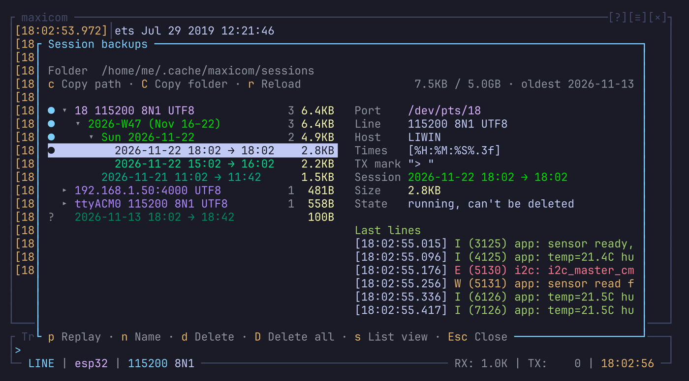<p align="center"><sub><b><a href="docs/guide/capture.md">Sessions</a>.</b> Every session backed up and restored at the next launch; browse them by device and date, and replay any.</sub></p></td>
  </tr>
  <tr>
    <td width="50%" valign="top">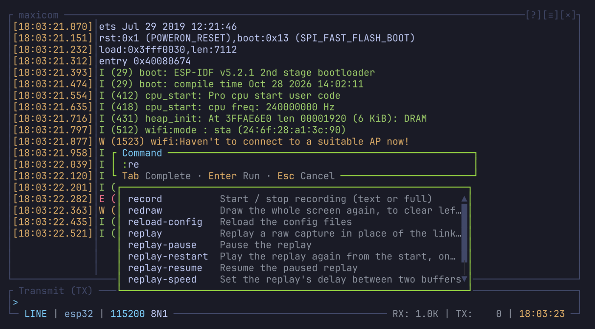<p align="center"><sub><b><a href="docs/guide/command-line.md">Command line</a>.</b> <code>send</code>, <code>dtr</code>, <code>break</code>, <code>mash</code> and more, with completion and help; name a command line and bind it to a key.</sub></p></td>
    <td width="50%" valign="top">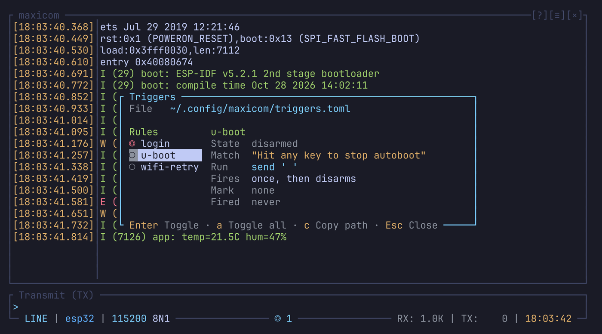<p align="center"><sub><b><a href="docs/guide/triggers.md">Triggers</a>.</b> Rules that watch what comes in and answer: stop at a boot prompt, log in, mark a crash.</sub></p></td>
  </tr>
  <tr>
    <td colspan="2">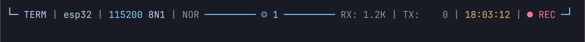<p align="center"><sub><b><a href="docs/guide/status-bar.md">Status bar</a>.</b> The link, its settings and what runs, in segments you pick and order.</sub></p></td>
  </tr>
</table>

## Features

- Two views of the same data: a terminal emulator for shells and full-screen
  programs, and a line mode for logs, with timestamps and an input box
- Scrollback, search, copy mode with vi keys, mouse selection
- A raw side panel with the bytes in hex, octal or binary, and in terminal
  mode which bytes drew each character on screen
- Live plots of the numbers your device prints (`temp=23.4`, the serial
  plotter format), next to the text
- Every session backed up and restored at the next launch; recordings and
  replays
- Saved links and a dialing directory, TCP links raw, telnet or RFC 2217
  (ser2net, ESP32 bridges, `esp_rfc2217_server`, QEMU), port locks shared with
  minicom and picocom
- A command line (`send`, `dtr`, `break`, `mash`...), named command lines on
  keys, triggers that answer boot prompts
- minicom's keys and options: `maxicom -D /dev/ttyUSB0 -b 115200`, then
  `Ctrl-a z` for the help
- Keys, colors, highlights and the status bar all configurable, per-device
  profiles that add keys, triggers and plots while a link uses them, and
  every config file reloaded live with `Ctrl-a r`

## Install

Download a prebuilt binary for Linux, macOS or Windows from the
[releases page](https://github.com/Pierre-Mollard/maxicom/releases). The
Linux builds are static, so they run on any distribution, old ones like
RHEL 8 included. Or build it with Cargo:

```bash
cargo install maxicom
```

No system library needed. Per-OS notes (serial port groups, macOS port names,
Windows Terminal, WSL2): [Install](docs/guide/install.md).

## Quick start

```bash
maxicom /dev/ttyUSB0            # COM3 on Windows; 115200 8N1 by default
maxicom /dev/ttyUSB0 -b 9600    # another baud rate
maxicom                         # pick a port in the directory
```

`Ctrl-a` is the prefix: `Ctrl-a z` lists the keys, `Ctrl-a m` switches
between terminal and line mode, `Ctrl-a q` quits. The ten things you'll do
most: [Quick start](docs/guide/quick-start.md).

## Documentation

The user guide is online at
[pierre-mollard.github.io/maxicom](https://pierre-mollard.github.io/maxicom/).
Its pages, which GitHub also shows:

- [Introduction](docs/guide/introduction.md)
- [Install](docs/guide/install.md)
- [Quick start](docs/guide/quick-start.md)
- [Coming from minicom](docs/guide/coming-from-minicom.md)
- [Popups](docs/guide/popups.md)
- [Links](docs/guide/links.md)
  - [The directory](docs/guide/directory.md)
  - [Saved links](docs/guide/saved-links.md)
  - [TCP links](docs/guide/tcp-links.md)
  - [Port locks](docs/guide/locks.md)
- [Line mode](docs/guide/line-mode.md)
- [Terminal mode](docs/guide/terminal-mode.md)
- [Encoding and newlines](docs/guide/encoding-and-newlines.md)
- [Characters drawn differently](docs/guide/drawn-characters.md)
- [Copy mode and mouse](docs/guide/copy-mode-and-mouse.md)
- [Search](docs/guide/search.md)
- [Marks](docs/guide/marks.md)
- [Raw side panel](docs/guide/raw-side-panel.md)
- [Plots](docs/guide/plots.md)
- [Triggers](docs/guide/triggers.md)
- [Profiles](docs/guide/profiles.md)
- [Capture](docs/guide/capture.md)
- [File transfers](docs/guide/file-transfers.md)
- [Notifications](docs/guide/notifications.md)
- [Command line](docs/guide/command-line.md)
- [Settings](docs/guide/settings.md)
- [Keybindings](docs/guide/keybindings.md)
- [Theme](docs/guide/theme.md)
- [Highlights](docs/guide/highlights.md)
- [Status bar](docs/guide/status-bar.md)
- [Troubleshooting](docs/guide/troubleshooting.md)
- [Messages](docs/guide/messages.md)
- [What maxicom doesn't do](docs/guide/limits.md)

What changed in each version: [CHANGELOG.md](CHANGELOG.md).

Building on maxicom: [CONTRIBUTING.md](CONTRIBUTING.md).
Reporting a security issue: [SECURITY.md](SECURITY.md).

### Author

Pierre Mollard

With [Claude Code](https://claude.com/claude-code) as pair programmer: a lot
of the code was written by Claude, and every line was reviewed by Pierre,
one item at a time.

<p>
  
</p>

<sub>Claude, reporting for duty: tests green, clippy quiet, thumbs up.</sub>

### License

Licensed under either of [Apache License, Version 2.0](LICENSE-APACHE) or
[MIT license](LICENSE-MIT) at your option.

Unless you explicitly state otherwise, any contribution intentionally submitted
for inclusion in maxicom by you, as defined in the Apache-2.0 license, shall be
dual licensed as above, without any additional terms or conditions.
