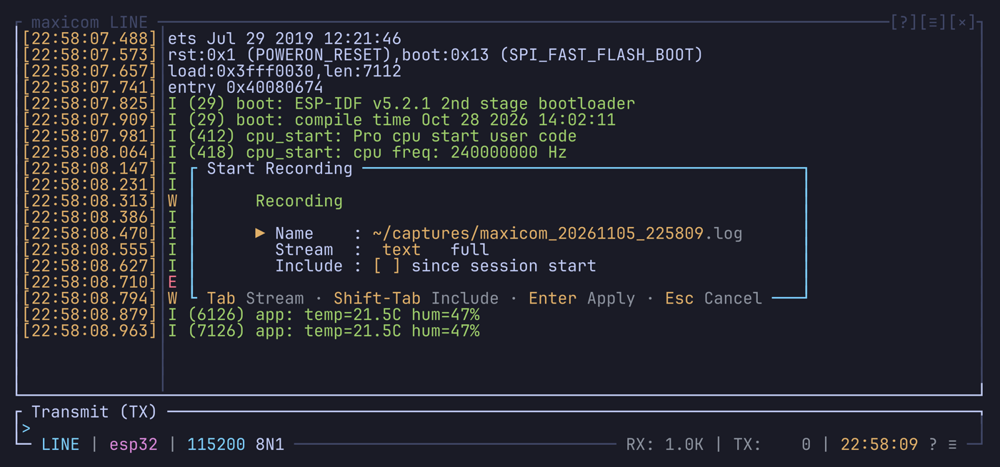
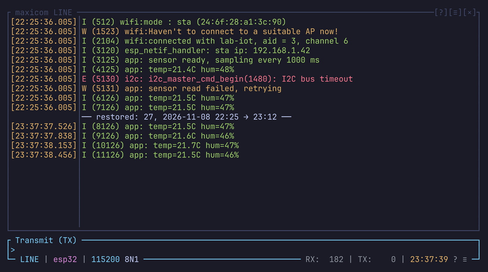
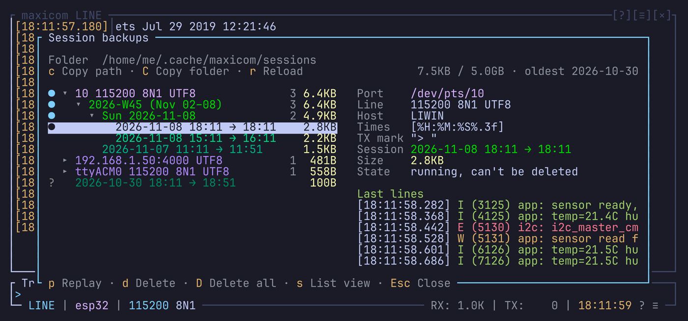

# Capture

maxicom can keep what the device sends in several ways:

- **recordings** that you start and stop;
- a **session backup** of everything, made on its own, which comes back at
  the next launch;
- **replays** of both;
- **screenshots** of the terminal.

## What is what

| Kind | Made | Holds | Replayable |
| --- | --- | --- | --- |
| Session backup | On its own, every session | A folder of files: raw bytes, times, info, text | Yes |
| Full recording | By you | The same files as a session, in a folder you choose | Yes |
| Text recording | By you | A `.log` file of decoded lines, to read | No |

### The files of a session

A session, or a full recording, is a folder `<name>/` holding:

| File | Holds |
| --- | --- |
| `<name>.raw` | The bytes exactly as received |
| `<name>.times` | When each chunk of bytes came |
| `<name>.meta` | What they were received on: the device, the line settings, the encoding, the terminal's size |
| `<name>.log` | The text, for you to read |

The `.raw`, `.times` and `.meta` together let a session replay and restore
as it was: both modes are rebuilt from the `.raw`. The `.log` is never read
back.

A text recording is only the `.log`: decoded, split into lines, with times
and marks added. That's why it can't be replayed.

## Recordings

### Starting a recording

`Ctrl-a l` (or Record… in the right-click menu) opens the recording dialog.
Its stream follows the mode you're in: text in line mode, full in terminal
mode.

The name is filled in for you, without an extension. The stream adds it,
shown after the name: `.log` for text, `/` for a full recording's folder.



On top of the [popup keys](popups.md):

| Key | Does |
| --- | --- |
| Enter | Starts recording |
| Tab | Switches between text and full |
| Shift-Tab | Includes everything since the session started |

With the session included, the recording first gets everything the session
backup holds, then goes on recording.

### Stopping

While a recording runs, `● REC` shows in the status bar. `Ctrl-a l` again,
or a click on `● REC`, stops it.

Only one recording runs at a time. A full recording includes the text, so
you don't need both.

### Text recordings

A text recording writes the received lines, decoded, one per line. With
`timestamp` on, each line starts with its time in `timestamp_format`.

In line mode, the lines you send are written too, after `tx_mark`.

If the device changes during the recording (another port, baud rate,
framing or encoding), it goes on, with a line marking the change:
`── device: ttyUSB1, 115200 8N1, UTF8 ──`.

### Full recordings

A full recording writes a folder like a session's: the received bytes, their
times, the text, and a `.meta`. You can replay it with
`maxicom --replay <folder>`, and the `.meta` makes the replay decode with
the right encoding and show the line settings it was recorded with.

During a replay, a full recording takes the replayed session's `.meta`. A
replayed file without one gives a recording without one.

With the session included, every file starts with the session's content,
and the `.meta` is the session's.

A full recording stops, with a notice, when the device changes: another
port, baud rate, framing or encoding, or a replay starting or ending.

## Session backup

Every session is recorded, raw and text, without you doing anything. Each
one gets its own folder:

```text
~/.cache/maxicom/sessions/<date>_<time>_<port>/
```

The time is to the millisecond. See [Install](install.md#where-its-files-are)
for the folder on other systems.

The backup is flushed every 250 ms, so a crash or a `kill` loses almost
nothing.

It doesn't light `● REC`, and it doesn't run during a replay. Your own
status bar can show it with the `session` condition, for example
`[◆](session?muted:hide)`. The default bar doesn't.

### Its text

The `.log` is written with `timestamp`, `timestamp_format`, `record_tx` and
`tx_mark` as they were when the session started. A reload changes these for
the recordings, never for a running backup.

### Cleaning up old sessions

When a session starts, maxicom removes:

1. the sessions that received nothing;
2. then the oldest ones, until all of them together fit in
   `sessions.max_size` (5 GiB by default), and at most `sessions.keep` are
   left when it is set (by default it is `0`, no limit: the size alone
   decides).

When old sessions are removed this way, a notification says how many, up to
which day, and their size. The session browser shows how full the folder is
next to its buttons.

The current session, and any still running in another maxicom, count in the
size but are never removed.

### Recovering a session by hand

Open its `.log` to read it, or replay it:

```bash
maxicom --replay ~/.cache/maxicom/sessions/20261028_141500123_ttyUSB0
```

Its `.meta` gives the replay the encoding and the line settings.

## Restore

When you open a device, its last session can come back in the history. This
happens at startup and on each switch to another device (through the
directory, `open`, or a saved link).

Line mode gets the lines back, and terminal mode the screen and scrollback.
A separator line follows, before the live data:

```text
── restored: ttyUSB0, 2026-10-28 14:15 → 16:40 ──
```



The terminal replays the session at the size it ended with, so wide lines
come back whole. Then `dimension_mode` sizes it to the view.

### Turning it on or off

`restore` in `[sessions]`:

| Value | Does |
| --- | --- |
| `always` (default) | Restores |
| `ask` | Asks each time |
| `never` | Doesn't restore |

`--restore` (restore without asking) and `--no-restore` decide for the whole
run, switches included.

Nothing is restored during a replay.

### Which session comes back

The last session of the same device: the same machine (hostname), port,
baud rate, data bits, parity, stop bits and encoding. It must also:

- have received something;
- not be running anymore;
- have ended within `restore_max_age` (`"0s"` means no limit).

Sessions from before the restore feature have no `.meta` and never come
back.

### The question

With `restore = "ask"`, Enter or `y` restores, and Esc or `n` skips. A click
outside the question doesn't answer it.

What arrives in the meantime waits, and shows after the restored part. If
more than 4 MiB arrives, the restore is skipped.

### What comes back

The last 1 MiB of the `.raw`, in both modes, cut into lines the way line
mode did live. Each line and row gets its time from the `.times`; a session
without one shows a blank time column.

The lines you sent in line mode were never received, so they don't come
back.

After the terminal part, any mode a full-screen program may have left on
(alternate screen, cursor keys, mouse reports, scroll region) is reset.

The restored part isn't backed up again or counted in RX. So the next launch
restores this session's own data, or the same old one again if this session
received nothing.

### Switching devices

A switch clears both modes and the RX / TX counts once the new device is
open, then restores as at startup. When you come back to the first device,
its own session comes back.

A device that fails to open leaves the screen as it was. New line settings
or a new encoding on the same port keep the history; only a new backup
starts.

## Session browser

`Ctrl-a j` (or Sessions… in the right-click menu) lists every backup on the
left, for any device, as a tree. It opens on the session running now, with the
groups above it open.

The right side shows what is selected. For a session, that's its device,
format, times, size and last lines. For a group, it's how many sessions it
holds, the time they span, their size, and the last lines of its newest
sessions one after the other.



### The tree

Sessions are grouped by device, then by month, week and day, the newest first:

```text
▾ ttyUSB0 115200 8N1 UTF8        43 sessions  38MB
  ▾ 2026-11                      31 sessions  27MB
    ▾ 2026-W45 (Nov 02–08)       12 sessions   9MB
      ▸ Sat 2026-11-07            7 sessions   4MB
        2026-11-06 10:00 → 11:30              1MB
```

A device group holds the sessions recorded on the same machine, address, line
settings and encoding. A session without a `.meta` stays alone at the top.

Weeks are ISO weeks, Monday to Sunday. A week belongs to the month of its
Thursday, so it never splits in two: a session from Monday, August 31 can show
under September when its week is mostly in September.

A group with a single child shows that child instead. A week of one day shows
the day, and a day of one session shows the session.

`sessions.group_by` picks the time levels, in any order. `["week", "day"]`
leaves months out, and `[]` puts the sessions right under their device. Without
a week level, months are calendar months. Nothing moves on disk: the tree is
only a way of showing the folder.

### Marks

| Mark | Means |
| --- | --- |
| `●` | Running; it can't be deleted |
| `○` | Restored into the history when the device opened |
| `?` | No `.meta`: from before the restore feature |

A group shows the mark of what it holds, so a closed one still tells you where
the running session is.

### Keys

On top of the [popup keys](popups.md):

| Key | Does |
| --- | --- |
| Enter | Open or close the selected group; replay the selected session |
| Right | Open the selected group |
| Left | Close the selected group, or go to the group above |
| `p` | Replay the selected session or group, see [Replaying a group](#replaying-a-group) |
| `d`, `Del` | Delete the selected session, or a group's sessions but the running ones, after a question |
| `D` | Delete all but the running ones, after a question |
| `s` | Switch between the tree and a list of all the sessions, newest first |
| `n` | [Name](#naming-a-session) the selected session |

### Naming a session

A session has a date and a port, which is little to tell a day of tests on one
board apart. `n` gives the selected session a name, kept in its `.meta`. Enter
saves it, Esc leaves it as it was, and an empty name takes it away.

The name shows in the tree and the list, in the session's details, and in the
separators of a [restore](#restore) and of a
[group replay](#replaying-a-group):

```text
── restored: boot test, ttyUSB0, 2026-11-07 10:15 → 16:15 ──
```

For the session running now, `n` works too, and so does
[`session-name`](command-line.md#naming-the-session) from the command line. A
new session starts without a name, even on the same device.

Only a session has a name: a group is a view of the folder, not something on
disk. A session without a `.meta` can't have one, and a session running in
another maxicom is named from that maxicom, which keeps its `.meta` up to date.

## Replay

A replay plays a recording as if a device sent it. It takes:

- a recording's folder, its `.raw` or its `.meta`;
- any `.raw` file, even another tool's capture, played without a meta.

A `.log` is refused: its text isn't what was received.

### Starting one

| From | Write |
| --- | --- |
| The shell | `maxicom --replay <path>` |
| The command line | `replay <path>` or `open file://<path>` |

By default it plays as fast as it can, one buffer after the other.
`--delay <ms>`, or `replay <path> <ms>`, waits that long between two
buffers, to watch a boot scroll by.

### Controlling it

| Command | Does |
| --- | --- |
| `replay-pause` / `replay-resume` | Pauses / resumes |
| `replay-speed <ms>` | Changes the delay |
| `replay-restart` | Plays it again from the top, on a clean screen |
| `replay-stop` | Goes back to the live link |

Run them from the [command line](command-line.md), or bind them to keys.

While it plays, the status bar shows `▷ RUN 42%` (then `PAUSE` or `END`),
from `{replay_state}` and `{replay_percent}`.

### Replaying a group

`p` on a group in the [session browser](#session-browser) loads all its
sessions at once, oldest first, so you can scroll and search a day or a week
together. There's nothing to wait for and no pace to set, so the commands
above don't apply to it, apart from `replay-stop`. A group holding the running
session stops just before it.

A line after each session marks where it ends:

```text
── end of session: ttyUSB0, 2026-11-07 09:00 → 11:30 ──
```

The group opens in terminal mode, on its last lines. Terminal mode only keeps
its `history_size` rows, so for a whole week, switch to line mode with
`Ctrl-a m`. For the replay, line mode gets a history of its own of 1,000,000
lines, or `line_mode.history_size` if that's more. Full-screen programs don't
draw in line mode, so read those parts in terminal mode.

A notification says when something doesn't fit:

| Notification | Means |
| --- | --- |
| `Loaded 12 sessions` | All of it is in both modes |
| `Loaded 12 sessions. Terminal mode keeps the last 100000 rows, line mode has them all` | Line mode has all of it, terminal mode the end |
| `Loaded the last 9 of 31 sessions: line mode holds 1000000 lines` | The oldest sessions aren't loaded |
| `Loaded 3 sessions without the start of the oldest: line mode holds 1000000 lines` | The oldest session is cut |

Only what the two modes can hold is read, so a huge group takes no longer to
open than a medium one. On a 50 MB group, it opened in about a second and used
about 490 MB. Going back to the live link frees that for maxicom to reuse, but
the system may not get it all back until maxicom quits.

### Back to the live link

A replay started from the app takes the live link's place, but the link
stays open behind it. To go back to it, use `Ctrl-a L`, a click on the
status bar's `« live`, or Back to live in the right-click menu.

Nothing is sent to a replay: commands that send are refused, and triggers
don't fire.

## Screenshots

Screenshots save the terminal's screen, in terminal mode only. In line mode,
the keys just say so.

| Key | The dialog opens on |
| --- | --- |
| `Ctrl-a k` (or Screenshot in the right-click menu) | `ansi`: `.ans`, with the colors |
| `Ctrl-a K` | `text`: `.txt`, the characters only |

The screen is taken at once, in both formats. A dialog then asks where to
save it: Enter saves to the path shown, Esc drops it, and Tab switches the
format.

The `screenshot <name>` command saves without the dialog, see
[Command line](command-line.md#search-and-screenshots).

## Paths and names

These rules apply to recordings and screenshots:

- a leading `~` is your home folder;
- missing folders are created;
- an empty `dir` is the current folder;
- names are strftime templates, filled in when the dialog opens.

## Settings

All in `config.toml`, shown with their defaults:

- `[capture]` sets the recordings; its text settings also apply to the
  session backup.
- `[sessions]` sets the session backup and the restore.
- `[screenshot]` sets the screenshots.

```toml
[capture]
dir = ""                                 # recordings folder
name = "maxicom_%Y%m%d_%H%M%S"           # no extension: .log, or a folder
timestamp = true                         # time on each text line
record_tx = true                         # sent lines in the text files (line mode)
tx_mark = "> "                           # before each sent line, "" for none

[sessions]
enabled = true                           # session backup (read at startup)
keep = 0                                 # sessions kept, 0: no limit (the size alone)
max_size = "5G"                          # all sessions, K/M/G/T, "0": no limit
group_by = ["month", "week", "day"]      # the session browser's tree, in any order
restore = "always"                       # always, ask or never
restore_max_age = "1day"                 # since it ended, "0s": no limit

[screenshot]
dir = ""
name = "screen_%Y%m%d_%H%M%S"            # the format adds .txt or .ans
```
