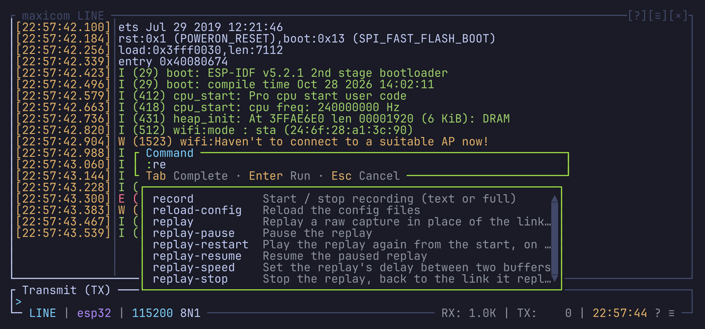

# Command line

`Ctrl-a :` opens a `:` prompt where you type commands. Enter runs the line,
Esc closes the prompt.

Every action of the [keybindings](keybindings.md#actions) is a command
(`toggle-local-echo`, `record`...), and the command line adds commands that
take arguments (`send`, `open`, `baud`...). Several commands chain with `;`:

```text
dtr off; sleep 100; dtr on
```

If a line has an unknown command or a bad argument, nothing in it runs: the
error shows and the prompt stays open so you can fix it.

This page lists every command. Those that belong to a topic, like `baud` or
`replay`, are explained in its chapter too, linked from each section here.
The ones that exist only as commands, like `send`, `mash` or `dtr`, are
explained here.



## Writing arguments

- Quote an argument that has spaces.
- `"..."` understands the escapes `\r`, `\n`, `\t` and `\xNN`.
- `'...'` is taken literally.
- A path or an address keeps its `\` as typed, for Windows:
  `replay C:\Users\me\boot.raw`, `open \\.\COM10`. There, `\` still escapes
  a space.

## Completion

As you type, the completions of the word before the cursor are listed:
command names with their help, then the values the argument accepts. The
selected command's usage and full help show under the list.

- Tab, Shift-Tab, Up and Down put each completion in place in turn.
- The mouse wheel scrolls the list.
- A single completion, or a click on one, is taken with a space after it.

An empty line, or a line recalled from the history, lists nothing until you
press Tab (which lists without picking) or type.

## History

When no completion list is shown, Up and Down walk through the lines that
ran, newest first, back to the line being typed. Only the lines starting
with what you typed are shown: type `send`, then Up, to walk the `send`
lines.

`history_size` in `[command_line]` (default `100`) sets how many lines are
kept, and a reload applies it at once. The history lasts for the session
only.

## Commands

### Sending data

| Command | Does |
| --- | --- |
| `send <text>` | Sends the text as is, its escapes as bytes: `send AT\r`, `send "hello world\r\n"` |
| `send-hex <bytes>` | Sends bytes written in hex, without spaces: `send-hex 0d0a` |
| `send-file <path> [line-delay-ms]` | Sends a file as it is, see below |
| `upload <xmodem\|xmodem-1k\|ymodem> <path>` | Sends a file to a receiver like U-Boot's `loady`, see below |
| `download <xmodem\|ymodem> [path]` | Receives files the device sends (`sb`, `sx`), see below |

#### Sending a file

`send-file` sends the file as is, paced to the baud rate and framing (10
bits a byte in 8N1, 12 in 8E2). With a delay, it waits that long after each
line, for a device without flow control.

`upload` sends it with XMODEM or YMODEM, to a receiver that checks each packet:
U-Boot's `loady` and `loadx`, `rx`, `rb`. It waits for the receiver to ask,
started before or after it.

`download` receives what the device sends with XMODEM or YMODEM, into
`[transfers] dir` or the folder given.

All show their progress on a row over the status bar, and `cancel` stops
them. The rest of the line doesn't wait for the file: `send-file a; send b`
sends `b` first. See [File transfers](file-transfers.md).

### Control lines and break

| Command | Does |
| --- | --- |
| `dtr on\|off` | Sets the DTR line |
| `rts on\|off` | Sets the RTS line. Refused with hardware flow control, since the driver drives RTS then. |
| `break [ms]` | Holds the line in break, 250 ms by default. The rest of the line waits for it to end. |

`true` / `false` and `1` / `0` work too.

### Port settings

| Command | Does |
| --- | --- |
| `baud <rate>` | Sets the baud rate |
| `framing <8N1>` | Sets the data bits, parity and stop bits |
| `flow none\|hw\|sw` | Sets the flow control |

They work like the [line settings popup](links.md#line-settings). On a
detached port, they are kept for when it opens.

The control lines, `break` and these three need a serial port: a TCP link
(whose bridge owns the lines and settings) and a replay refuse them.

### While the port isn't open

When the port is detached, lost or reconnecting, `send`, `send-file`,
`upload`, `download` and the control lines are refused. `baud`, `framing` and
`flow` are kept for when it opens.

### Switching links

`open <name | address>` switches to another link, like picking it in the
[directory](directory.md). See [Switching links](links.md#switching-links).

```text
open board                      # a saved link, with its line settings
open /dev/ttyUSB1               # another port, current line settings kept
open tcp://192.168.1.50:4000    # a TCP link
open file://boot.raw            # a replay
```

- A saved name is looked for before a device.
- A bad address is refused before the line runs.
- It completes the saved links, the schemes and the serial ports the system
  lists, then paths after `file://` or a `/`.
- The rest of the line waits until the link is open:
  `open COM4; send AT\r`.
- If the port fails to open, the previous link comes back, its screen as it
  was.
- Another device starts on a clean screen, with its last session restored
  and its own backup (see [Restore](capture.md#restore)). With
  `restore = "ask"`, the rest of the line waits for your answer.

`toggle-attach` detaches and attaches the link, like `Ctrl-a D`.

### Replay

| Command | Does |
| --- | --- |
| `replay <path> [delay-ms]` | Plays a recording in the link's place, waiting `delay-ms` (0 to 10000, none by default) between buffers. Same as `open file://path`. |
| `replay-stop` | Goes back to the live link |
| `replay-pause` / `replay-resume` | Pauses / resumes |
| `replay-speed <delay-ms>` | Changes the delay |
| `replay-restart` | Plays it again from the top |

See [Replay](capture.md#replay). A [group replay](capture.md#replaying-a-group)
is loaded at once, so only `replay-stop` applies to it.

### Saved links

| Command | Does |
| --- | --- |
| `link-save [name]` | Saves the link in use to `links.toml`, under its address's name when none is given (`ttyUSB0`) |
| `link-delete <name>` | Deletes a saved link; the names complete |

Both refuse what the [directory](directory.md) refuses, and stop the rest of
the line. See [Saved links](saved-links.md).

### Naming the session

| Command | Does |
| --- | --- |
| `session-name [text]` | [Names](capture.md#naming-a-session) the running session, in quotes when it has spaces; without text, takes its name away |

Without a running session it refuses, and stops the rest of the line.

### Settings

| Command | Does |
| --- | --- |
| `set <setting> on\|off` | Sets `local-echo`, `timestamps`, `mouse`, `answer-queries`, `add-cr` or `add-lf`. Does nothing when it's already so. |
| `encoding utf8\|ascii\|cp437\|latin1` | Sets how the received bytes are read |

Settings with more than two values cycle with their keys. See
[Setting a value directly](settings.md#setting-a-value-directly) and
[Text encoding](encoding-and-newlines.md#text-encoding).

### Search and screenshots

| Command | Does |
| --- | --- |
| `search <text>` | Starts a search forward for the text in copy mode, the bar open on it |
| `screenshot <name>` | Saves the terminal at once, without the dialog. Terminal mode only. |

A bare screenshot name is saved in `screenshot.dir`. A `.ans` name keeps
the colors; anything else is text, and `.txt` is added to a name without an
extension. See [Search](search.md) and [Screenshots](capture.md#screenshots).

### Waiting and stopping

| Command | Does |
| --- | --- |
| `sleep <ms>` | The rest of the line waits that long, up to a minute. The screen stays live. |
| `cancel` | Stops the file being sent and a `mash`, and drops the commands waiting |

A line run while another is waiting runs after it. A line starting with
`cancel` is the exception: it runs at once, so `cancel; send x` doesn't wait.

### Waiting for a prompt: `mash`

```text
mash <text> <until> [every-ms] [timeout-ms]
```

`mash` sends the text at once, then again every 50 ms (by default) until
`until` comes in, for at most 15 seconds. It's made for bootloaders that
only listen for a moment after a reset.

The rest of the line waits for `until`:

```text
mash ' ' '=> '; send 'printenv\r'
```

The timeout, a key typed for the device, `cancel`, a detach or a lost link
stop it, and drop the rest of the line.

While it runs, the status bar shows `⟳ mash`; a click stops it.

With a reset first, on one key:

```text
dtr off; rts on; rts off; mash ' ' '=> '
```

### Triggers

`trigger on|off|toggle [name]` arms, disarms or toggles all the triggers,
or the one named. The names complete. See [Triggers](triggers.md).

### Plots

| Command | Does |
| --- | --- |
| `plot <name>` | Shows that plot. The names complete. |
| `plot off` | Hides it |
| `plot` | Shows the next plot, off after the last |
| `plot-freeze` | Freezes the chart, or gives it back live |

See [Plots](plots.md).

### Notifications

| Command | Does |
| --- | --- |
| `notify <info\|success\|warn\|error> <text>` | Shows a notification of yours: `notify warn "power-cycle the board"` |

It follows the rules of maxicom's own: see [Notifications](notifications.md).
It sends nothing to the device, so a [trigger](triggers.md) or a key bound to
a command line can use it to tell you something, like a boot that failed.

### Marks

| Command | Does |
| --- | --- |
| `mark [letter]` | Marks the line you're looking at; without a letter, waits for it as the next key |
| `jump-mark [letter]` | Jumps to a mark; without a letter, waits for it |
| `delete-mark <letter>` | Removes a mark |

See [Marks](marks.md).

### Commands the link can't run

A command the link can't do, like anything that sends during a replay, stops
the line there and shows the error.

## Binding a command line to a key

In `keymap.toml`, a key in `[prefix_actions]`, `[direct_actions]` or
`[copy_mode]` can take a command line instead of an action name, like
tmux's `bind`.

For example, put an ESP32 in its bootloader with one key, the way esptool
does it, and send Ctrl-c as a byte with another:

```toml
[prefix_actions]
F6 = "dtr off; rts on; sleep 100; dtr on; rts off; sleep 50; dtr off"

[direct_actions]
F5 = "send-hex 03"
```

The key runs its line as if you typed it:

- it runs after a line still waiting, unless it starts with `cancel`;
- it doesn't go in the history;
- a `[prefix_actions]` or `[direct_actions]` key does nothing in copy mode
  and search, like the other keys of these sections;
- a `[copy_mode]` key runs its line in copy mode: `x = "send-hex 03"` there
  sends Ctrl-c while you copy.

A line that doesn't parse stops the keymap from loading, naming its key. A
reload keeps the keymap in use.

### The default bound lines

| Key | Line | Does |
| --- | --- | --- |
| `Ctrl-a f` | `break` | Sends a break |
| `Ctrl-a g` | `plot` | Shows the next plot |
| `Ctrl-a h` | `dtr off; sleep 100; dtr on` | Pulses DTR, which resets most boards |
| `Ctrl-a L` | `replay-stop` | Goes back to the live link from a replay |
| `Ctrl-a U` | `trigger toggle u-boot` | Toggles the `u-boot` trigger |
| `Ctrl-a ,`, `,` in copy mode | `mark` | Marks a line, waiting for its letter |

The help's Commands tab lists every command and the keys bound to a line.

## Look

`layout` in `[command_line]` sets where the prompt shows:

- `"popup"` (default): a centered popup, one row high;
- `"status_bar"`: over the status bar's row, or in the popup when the status
  bar is hidden.

Its colors are `[command_line]` in `theme.toml`: `border` (the popup's and
the list's), `prompt` (the `:`), `text`, and `selected` (the completion
picked in the list).
