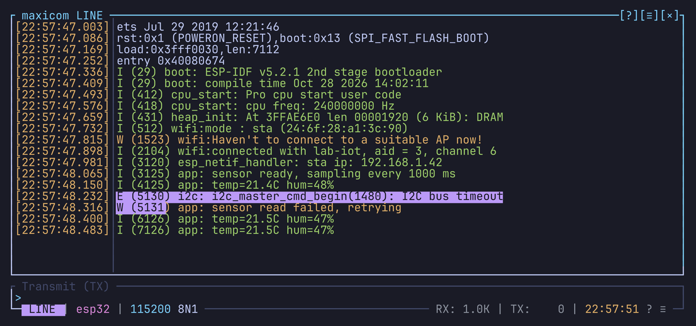

# Copy mode and mouse

## Scrolling

| Key | Scrolls |
| --- | --- |
| `Shift-PageUp` / `Shift-PageDown` | A page up / down |
| `Shift-Home` | To the top |
| `Shift-End` | Back to the live output |
| `Ctrl-a PageUp` / `Ctrl-a PageDown` | A page up / down |
| `Ctrl-a Up` / `Ctrl-a Down` | A line up / down |
| `PageUp` / `PageDown` | A page, in line mode only |
| The mouse wheel | The view under the pointer: the history or the raw side panel |

The `Shift-` keys work without the prefix.

The status bar shows where you are: `TOP`, `42%` or `BOT`. A click on it
takes you back to the live output, like `Shift-End`.

Data that arrives while you are scrolled up doesn't move the view.

## Copy mode

Copy mode puts a cursor in the history, so you can select text with the
keyboard. Enter it with `Ctrl-a [` or `Ctrl-a b`. The mode badge in the
status bar reads `COPY` and turns magenta. It works the same in line and
terminal mode.

The cursor starts where you are looking: at the start of the view's bottom
line when you have scrolled up. From the live view, it starts on the last
line in line mode, and on the device's cursor in terminal mode, or on the
last line with text when the device's cursor sits on an empty row.

### Keys

| Key | Does |
| --- | --- |
| `h` `j` `k` `l`, arrows | Move the cursor |
| `w` `b` `e`, `W` `B` `E`, `ge` `gE` | Move by word, as in vi |
| `0` `^` / `$` | Start / end of the line |
| `gg` / `G` | Top / bottom of the history |
| `Ctrl-u` `Ctrl-b` / `Ctrl-d` `Ctrl-f`, PageUp / PageDown | A page up / down |
| `Ctrl-y` / `Ctrl-e` | Scroll the view a line; the cursor stays |
| `v` or Space | Start a selection at the cursor |
| `V` | Select whole lines |
| `iw` `aw` `i"` `i(` `i[` `i{`... | Select a word, or what's inside quotes or brackets |
| `y` or Enter | Copy the selection and leave |
| `Y` | Copy the selection's bytes as the raw side panel shows them |
| Tab | Move the cursor to the raw side panel and back |
| `,` | Mark the cursor's line: then a letter, see [Marks](marks.md) |
| `'` | Open the marks popup, a letter jumps there |
| `(` / `)` | To the mark above / below |
| `/` / `?` | Search forward / backward from the cursor, see [Search](search.md) |
| `n` / `N` | Next match of the last search / the other way |
| `q` or Esc | Leave |

### The view while copying

Copy mode holds the view still while data arrives, so your selection stays
where it is. Leaving copy mode (Esc, or a copy) takes you back to the live
output.

If you had scrolled up before entering copy mode, the view stays where you
left it.

On a view wider than the screen, the cursor pans the view as it moves.
Leaving copy mode gives back the pan you had when you entered it.

### Where the copy goes

A copy goes to the system clipboard through your terminal, with the OSC 52
sequence. Your terminal must allow it:

- Windows Terminal, kitty, WezTerm, Alacritty and iTerm2 do;
- in tmux, add `set -g set-clipboard on`.

A notification says how many characters were copied. maxicom also keeps the
last copy itself, for a right-click or middle-click paste.

### Colors

`[ui.selection]` in the theme styles the selection. While the cursor is in
the raw side panel, `[ui.selection_raw]` is used instead, and the badge
turns red. See [Theme](theme.md).

## Mouse

### Selecting text

| Action | Copies |
| --- | --- |
| Drag | What the drag covers, when you release |
| Double click | The word |
| Triple click | The line |

### Clicking in the history

- In line mode, a click enters copy mode on the cell you clicked.
- In terminal mode, a click only gives the focus, so your typing still
  reaches the device.
- In copy mode, a click moves the cursor.

The click that brings maxicom's window to the front doesn't select anything.
This needs a terminal that reports focus changes, as Windows Terminal and
most others do.

When a program on the device asks for the mouse (vim, htop), it gets the
clicks instead, outside copy mode.

### Right-click menu

A right click opens a menu of the main actions at the pointer: switch the
mode, Help, Settings, Directory, Search, Record (or Stop recording),
Screenshot and Terminal size (terminal mode), Sessions, Triggers, Clear,
Clear history, Back to live (during a replay), Reload config, Quit.

Scrolled up or in copy mode, it also has Add mark, which marks the line
clicked; and while there are marks, Marks…, which opens the marks popup. See
[Marks](marks.md).

### Right-click paste

Over the place where you type, a right click pastes the last copy instead of
opening the menu:

- in line mode, over the input box, into the input box;
- in terminal mode, over the cursor's row on the live screen, to the device.

### Middle-click paste

A middle click pastes the last copy anywhere in the window, like the
selection paste of Linux terminals: into the input box in line mode, to the
device in terminal mode. It does nothing over a popup, or before your first
copy.

It pastes maxicom's last copy, not the system clipboard. When the device's
program uses the mouse, like the right click, the middle click goes to it
instead.

In terminal mode the paste goes straight to the device. If a middle click
happens by accident (pressing the scroll wheel, a touchpad tap), or the
device takes any input as a command, set `middle_click_paste = false` in
`[ui]` and the middle click does nothing.

### What else reacts to clicks

The status bar's blocks, the history title's `SCROLL +n` and `PAN +n`, the
popups' fields, tabs and buttons, and the notifications.

### Turning the mouse off

`mouse` in `[ui]` (default `true`) turns mouse support on. `Ctrl-a M`, or
`U` in the settings popup, switches it.

With the mouse off, your terminal's own selection works as usual. Many
terminals also give you their own selection while you hold Shift, even with
the mouse on.
