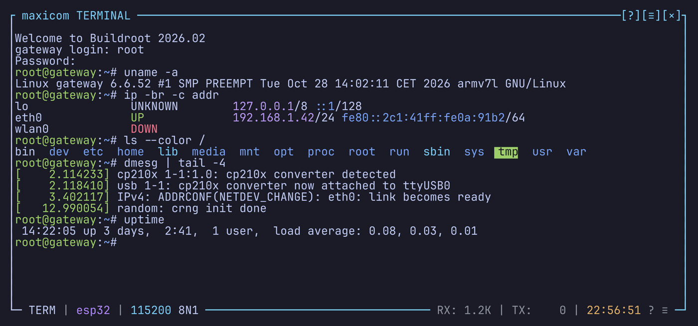
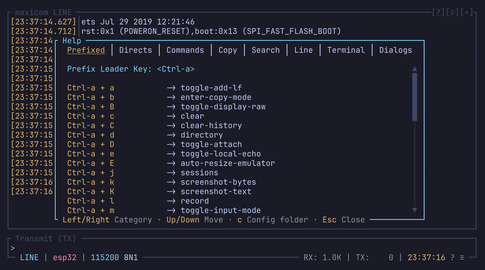

# Introduction

maxicom is a serial terminal for the console, in the spirit of minicom. It
opens a serial port, or a device reached over TCP, shows what the device
sends, and sends it what you type. It runs on Linux, macOS and Windows.

Beyond the basics, it gives you:

- two views of the same data, a terminal and a line-based log viewer;
- a scrollback with copy and search;
- recordings, and a backup of every session that comes back at the next
  launch;
- a panel showing the raw bytes;
- a command line, and triggers that answer boot prompts for you;
- a status bar you can rewrite.

## Two modes

Everything the device sends feeds two views. `Ctrl-a m` switches between
them.

**Terminal mode** is the default. It is a terminal emulator: colors, cursor
moves and full-screen programs (vim, top, menuconfig) work as in a local
terminal. Each key goes to the device as you type it, and Enter sends CR. Use
it for a shell on the device. See [Terminal mode](terminal-mode.md).

**Line mode** is a log viewer with an input box. The received text is cut
into lines, with optional timestamps, wrapping and several display modes
(text, raw, hex...). You write a line in the input box and Enter sends it.
Use it for logs and AT-style commands. See [Line mode](line-mode.md).

`mode` in `config.toml` picks the mode at startup (`"terminal"` or
`"line"`).

Both views are kept up to date all the time, so switching shows the whole
history in the other mode. This is `dual_mode_buffering = "always_both"`. On
a very fast link, `"active_only"` feeds only the mode on screen, which saves
work.

## The screen

| Part | What it shows |
| --- | --- |
| History box | The device's output, in the current mode. Its title says the mode: ` maxicom LINE ` or ` maxicom TERMINAL `. |
| Input box | Line mode only: the line you are writing. |
| Status bar | In the bottom border by default: the mode, the link and its settings, what's running (a recording, a file being sent, armed triggers), the scroll position, RX / TX counts, the time, and `?` / `≡` for the help and the settings. Most of its blocks react to a click. See [Status bar](status-bar.md). |
| Raw side panel | Off by default (`Ctrl-a B`): the bytes as received, in hex, octal or binary. See [Raw side panel](raw-side-panel.md). |
| Notifications | Short messages in the top right corner. See [Notifications](notifications.md). |

This guide calls the part of the history box you see **the view**. Moving
the view up and down is scrolling; moving it sideways, over lines wider than
the box, is **panning**.

### Clearing the screen

| Key | Does |
| --- | --- |
| `Ctrl-a c` | Clears the view. What was on it moves up into the history, a scroll up away. |
| `Ctrl-a C` | Clears the history too: everything received so far is gone from the view and the scrollback |

Both act on the mode you're in; the other mode keeps its history. Neither
touches the [session backup](capture.md#session-backup) or a recording.

## The prefix

What you type goes to the device. maxicom's own keys come after a prefix,
`Ctrl-a`: press `Ctrl-a`, let go, then press the key. For example `Ctrl-a z`
opens the help.

- `Ctrl-a Ctrl-a` sends a real `Ctrl-a` to the device.
- A few keys work without the prefix: `Ctrl-q` quits, `Shift-PageUp`
  scrolls.
- Every key can be changed, the prefix included. See
  [Keybindings](keybindings.md).

## How keys are written

This guide writes keys the way maxicom shows them:

- A letter is written as you type it, so `c` and `C` (Shift-c) are two
  different keys.
- `Ctrl-a` is the prefix, and `Ctrl-C` would be Ctrl-Shift-c.
- `Shift-` is only written on keys that have no uppercase form:
  `Shift-Tab`, `Shift-Right`, `Shift-PageUp`.

## Finding your way

| To | Press |
| --- | --- |
| See every key, by section, and the commands | `Ctrl-a z` |
| Change the common settings, each with its key | `Ctrl-a o` (or `Ctrl-a s`) |
| Reach the main actions with the mouse | A right click |
| Run a command, with completion | `Ctrl-a :`, the [command line](command-line.md) |

New to maxicom? Start with [Install](install.md), then the
[Quick start](quick-start.md). Used to minicom? Read
[Coming from minicom](coming-from-minicom.md).
