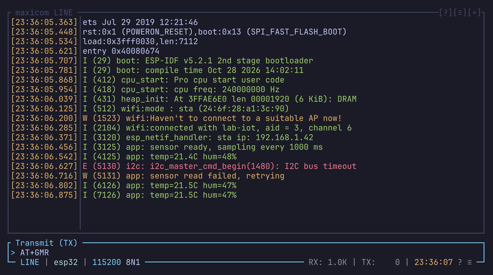

# Line mode

Line mode shows the received text as lines, one under the other, and gives
you an input box to write a line before sending it. It suits logs, AT
commands and anything line-based.

`Ctrl-a m` switches to line mode and back. To start in it, set
`mode = "line"` in `config.toml`.

## Sending a line

What you type goes to the input box at the bottom, not to the device. Enter
sends the line.

### Line ending

Enter adds `tx_eol` (in `[line_mode]`) after the line:

| Value | Sends |
| --- | --- |
| `lf` (default) | LF |
| `cr` | CR |
| `crlf` | CR LF |

`N` (Line Enter) in the settings popup cycles it.

### Sent history

Up and Down (or Ctrl-p and Ctrl-n) walk through the lines you sent, newest
first. `send_history_size` (default `1000`) sets how many are kept. The
history lasts for the session only.

### Special keys

| Key | Does |
| --- | --- |
| `Ctrl-u` | Clears the line |
| `Ctrl-c` | Sends a Ctrl-c byte (`0x03`) to the device at once |

### Local echo

Many devices echo what they receive, so you see your line come back. For a
device that doesn't, turn on `local_echo` (`Ctrl-a e`, off by default): the
lines you send are also shown in the history.

## Editing the line

| Key | Does |
| --- | --- |
| Left / Right | Move a character |
| Home / End | Go to the start / end |
| Ctrl-Left / Ctrl-Right, Alt-b / Alt-f | Move a word |
| Ctrl-w | Delete the word before the cursor |
| Alt-d | Delete the word after the cursor |
| Ctrl-k | Delete up to the end |
| Ctrl-d, Del | Delete the character under the cursor |

A line longer than the box scrolls inside it. `◀` and `▶` show at the edges
while text is hidden there (`prompt_hidden_left` / `prompt_hidden_right`).

### Pasting

Your terminal's paste, or a right click over the input box after copying in
maxicom, inserts the text in the line.

If the text has newlines, each complete line is sent as if you pressed
Enter, and the last part stays in the box.

### Vi keys

Esc puts the input box in normal mode: the prompt changes from `>` (set by
`prompt_prefix`) to `<` (`prompt_vi_prefix`), and keys move the cursor
instead of typing. `i` goes back to typing.

| Keys | Do |
| --- | --- |
| `h` `l` | Move a character |
| `w` `b` `e` | Move by word |
| `W` `B` `E` | Move by word, punctuation included |
| `ge` `gE` | End of the previous word |
| `0` `^` `gh` | Start of the line |
| `$` `gl` | End of the line |
| `i` `a` | Insert before / after the cursor |
| `I` `A` | Insert at the start / end |
| `x` | Delete the character |
| `D` | Delete up to the end |
| `C` | Delete up to the end, then type |

The operators `d` and `c` take a motion: `dw`, `cw`, `db`, `d$`, `d0`, and
`dd` / `cc` for the whole line.

They also take a text object: `diw`, `daw`, `ci"`, `ci'`, `ci(`, `ci[`,
`ci{`. With `i` the object is the inside; with `a` it includes the
delimiters.

## Reading the output

PageUp and PageDown scroll the history without the prefix, as do the mouse
wheel and `Shift-PageUp` / `Shift-PageDown`. See
[Scrolling](copy-mode-and-mouse.md#scrolling).

### Display mode

`display_mode` in `[line_mode]` sets how lines are shown. `D` in the
settings popup cycles it.

| Mode | Shows |
| --- | --- |
| `pretty` (default) | The text with the device's colors, other escape sequences hidden |
| `clean` | The text without colors |
| `raw` | Control characters made visible: `^[` for ESC, `\r`, `\xNN` |
| `hex`, `octal`, `binary` | Every byte of the line as numbers |

### Wrapping

`wrap_mode` decides what happens to lines wider than the view. `Ctrl-a w`
cycles it.

| Mode | Long lines |
| --- | --- |
| `word` (default) | Wrap at a space |
| `char` | Wrap at the edge |
| `truncate` | Are cut; you pan sideways to read them |

To pan, use `Ctrl-a Left` / `Ctrl-a Right`, or the arrows in the status bar.
`pan-home` goes back to the left edge.

`wrap_indent` sets where a wrapped row starts. `I` in the settings popup
cycles it.

| Value | A wrapped row starts |
| --- | --- |
| `timestamp` (default) | Under the text, past the timestamp |
| `prefix` | Past the row mark only |
| `none` | At the left edge |

### Row marks

`prefix_place` marks each row so you can tell lines from wrapped rows. `P`
in the settings popup cycles it.

- `border` (default) marks the rows in the left border: `│` a line, `┆` a
  wrapped row, `╎` the line still coming in.
- `inset` writes the strings of `[line_mode.inset_prefix]` before the text:
  `line = "> "`, `wrap = "  "`, `partial = "… "`.
- `none` marks nothing.

### Timestamps

`Ctrl-a t` shows the time each line came in (`show_timestamps`).
`timestamp_format` sets the format, in strftime syntax, by default
`[%H:%M:%S%.3f]`. Terminal mode shares the setting.

### Other settings

| Setting | Default | Does |
| --- | --- | --- |
| `show_partial_rx` | `true` | Shows the line still coming in as it grows. Off, a line shows once it ends. |
| `entry_spacing` | `0` | Blank rows between two lines |
| `history_size` | `1000` | Lines kept; older ones are dropped. Read at startup. |
| `unfocused_cursor_glyph` | `█` | The cursor drawn while the input box isn't focused |

## Telling the device the width

Alt-r sends `stty cols C; export COLUMNS=C`, with the width of the history
box, so a shell on the device wraps where line mode does. See
[Serial shells](terminal-mode.md#serial-shells).

## See also

How received newlines and the text encoding are handled, in both modes:
[Encoding and newlines](encoding-and-newlines.md).
