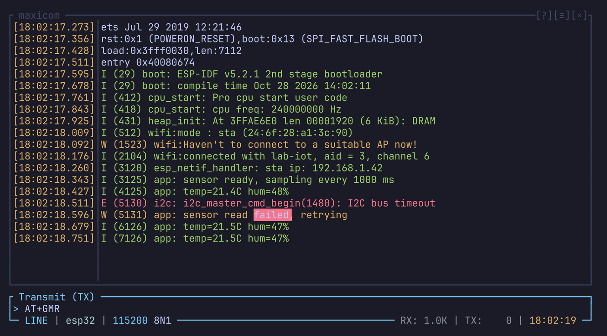

# Line mode

Line mode shows the received text as lines, one under the other, and gives
you an input box to write a line before sending it. It suits logs, AT
commands and anything line-based.

`Ctrl-a m` switches to line mode and back. To start in it, set
`mode = "line"` in `config.toml`.



## Sending a line

What you type goes to the input box at the bottom, not to the device. Enter
sends the line.

### Line ending

Enter adds `tx_eol` (in `[line_mode]`) after the line:

| Value | Sends |
| --- | --- |
| `lf` (default) | LF |
| `cr` | CR |
| `crlf` | CR LF |

`N` (Line Enter) in the settings popup cycles it.

### Sent history

Up and Down (or Ctrl-p and Ctrl-n) walk through the lines you sent, newest
first. `send_history_size` (default `1000`) sets how many are kept. The
history lasts for the session only.

This history is maxicom's own. The history of a shell on the device is only
reachable in terminal mode, see
[When the device is a shell](#when-the-device-is-a-shell).

### Special keys

| Key | Does |
| --- | --- |
| `Ctrl-u` | Clears the line |
| `Ctrl-c` | Sends a Ctrl-c byte (`0x03`) to the device at once |

### Local echo

Many devices echo what they receive, so you see your line come back. For a
device that doesn't, turn on `local_echo` (`Ctrl-a e`, off by default): the
lines you send are also shown in the history.

## Editing the line

| Key | Does |
| --- | --- |
| Left / Right | Move a character |
| Home / End | Go to the start / end |
| Ctrl-Left / Ctrl-Right, Alt-b / Alt-f | Move a word |
| Ctrl-w | Delete the word before the cursor |
| Alt-d | Delete the word after the cursor |
| Ctrl-k | Delete up to the end |
| Ctrl-d, Del | Delete the character under the cursor |

A line longer than the box scrolls inside it. `◀` and `▶` show at the edges
while text is hidden there (`prompt_hidden_left` / `prompt_hidden_right`).

### Pasting

Your terminal's paste, or a right click over the input box after copying in
maxicom, inserts the text in the line.

If the text has newlines, each complete line is sent as if you pressed
Enter, and the last part stays in the box.

### Vi keys

Esc puts the input box in normal mode: the prompt changes from `>` (set by
`prompt_prefix`) to `<` (`prompt_vi_prefix`), and keys move the cursor
instead of typing. `i` goes back to typing.

| Keys | Do |
| --- | --- |
| `h` `l` | Move a character |
| `w` `b` `e` | Move by word |
| `W` `B` `E` | Move by word, punctuation included |
| `ge` `gE` | End of the previous word |
| `0` `^` `gh` | Start of the line |
| `$` `gl` | End of the line |
| `i` `a` | Insert before / after the cursor |
| `I` `A` | Insert at the start / end |
| `x` | Delete the character |
| `D` | Delete up to the end |
| `C` | Delete up to the end, then type |

The operators `d` and `c` take a motion: `dw`, `cw`, `db`, `d$`, `d0`, and
`dd` / `cc` for the whole line.

They also take a text object: `diw`, `daw`, `ci"`, `ci'`, `ci(`, `ci[`,
`ci{`. With `i` the object is the inside; with `a` it includes the
delimiters.

## Reading the output

PageUp and PageDown scroll the history without the prefix, as do the mouse
wheel and `Shift-PageUp` / `Shift-PageDown`. See
[Scrolling](copy-mode-and-mouse.md#scrolling).

### Display mode

`display_mode` in `[line_mode]` sets how lines are shown. `D` in the
settings popup cycles it.

| Mode | Shows |
| --- | --- |
| `pretty` (default) | The text with the device's colors, other escape sequences hidden |
| `clean` | The text without colors |
| `raw` | Control characters made visible: `^[` for ESC, `\r`, `\xNN` |
| `hex`, `octal`, `binary` | Every byte of the line as numbers |

### Wrapping

`wrap_mode` decides what happens to lines wider than the view. `Ctrl-a w`
cycles it.

| Mode | Long lines |
| --- | --- |
| `word` (default) | Wrap at a space |
| `char` | Wrap at the edge |
| `truncate` | Are cut; you pan sideways to read them |

To pan, use `Ctrl-a Left` / `Ctrl-a Right`, or the arrows in the status bar.
`Ctrl-a 0` goes back to the left edge, and `Ctrl-a $` to the end of the
widest line.

`wrap_indent` sets where a wrapped row starts. `I` in the settings popup
cycles it.

| Value | A wrapped row starts |
| --- | --- |
| `timestamp` (default) | Under the text, past the timestamp |
| `prefix` | Past the row mark only |
| `none` | At the left edge |

### Row marks

`prefix_place` marks each row so you can tell lines from wrapped rows. `P`
in the settings popup cycles it.

- `border` (default) marks the rows in the left border: `│` a line, `┆` a
  wrapped row, `╎` the line still coming in.
- `inset` writes the strings of `[line_mode.inset_prefix]` before the text:
  `line = "> "`, `wrap = "  "`, `partial = "… "`.
- `none` marks nothing.

### Timestamps

`Ctrl-a t` shows the time each line came in (`show_timestamps`).
`timestamp_format` sets the format, in strftime syntax, by default
`[%H:%M:%S%.3f]`. Terminal mode shares the setting.

### Other settings

| Setting | Default | Does |
| --- | --- | --- |
| `show_partial_rx` | `true` | Shows the line still coming in as it grows, and lets [copy mode](copy-mode-and-mouse.md#the-line-still-coming-in) select in it. Off, a line shows once it ends. |
| `entry_spacing` | `0` | Blank rows between two lines |
| `history_size` | `250000` | Lines kept; older ones are dropped. Read at startup. See [History size](#history-size). |
| `unfocused_cursor_glyph` | `█` | The cursor drawn while the input box isn't focused |
| `shell_hint` | `true` | Tells you once when the device looks like a shell, see [The shell hint](#the-shell-hint) |

## History size

Line mode keeps more than [terminal mode](terminal-mode.md#scrollback),
because a line costs much less than a row of the terminal grid. Memory is
only used as the history fills.

With the default `dual_mode_buffering`, both modes receive everything. A full
history of 250,000 lines of about 80 characters then takes roughly 325 MB, on
top of the terminal's scrollback; with both full at 80 columns, maxicom used
about 575 MB. Each line costs more than its text because the two modes' memory
gets interleaved. With `dual_mode_buffering = "active_only"`, the same history
takes about 40 MB.

Lower `history_size` if memory is short.

### Counting the rows

The scrollbar needs to know how many rows the whole history takes. Line mode
counts them on its first draw, and again when something changes how lines
are laid out: a resize, a side panel, timestamps, the display or wrap mode.
A line of plain ASCII text that fits on one row is counted at once, colors
included: a full history of such lines takes a few milliseconds. The others
(accents, symbols, lines that wrap) are measured one by one, about 2 µs
each.

When that takes longer than a frame, it goes on over the next frames and a
small box top left says so:

```text
┌──────────────────┐
│ ⠹ Counting lines │
└──────────────────┘
```

The history shows and scrolls meanwhile; only the scrollbar is off until the
count ends, and the box goes.

## When the device is a shell

A shell on the device (bash, busybox, an embedded console) edits its own
line: it keeps its own history, completes words on Tab and redraws the line
as you type. That only works in terminal mode, where each key goes to the
device as you press it.

Line mode sends whole lines. Up and Down walk maxicom's history, not the
shell's, and Tab does nothing. Line mode never fakes the shell's history:
the shell answers an Up key by redrawing its line, and the line would then be
sent twice.

### The shell hint

maxicom watches what the device sends for signs of a shell. When it sees
one, a notification tells you that `Ctrl-a m` switches to terminal mode, once
per link.

| Sign | Who sends it | The hint shows |
| --- | --- | --- |
| A terminal query, like `ESC [ 5 n` | Embedded consoles that check for a terminal, some busybox builds, recent systemd, full-screen programs | At once |
| Bracketed paste turned on (`ESC [ ? 2004 h`) | bash 5.1 and later, zsh, fish, at each prompt | When you press Up or Down |
| Prompt marks (OSC 133) | Shells set up for them | When you press Up or Down |
| None | | When you press Tab |

A query shows the hint at once because line mode doesn't answer it. A
console that asks at startup and gets no answer may turn its line editing
and history off until it restarts: switch to terminal mode, then restart the
device.

Tab needs no sign: it does nothing in line mode, so pressing it means you
expect the device to complete.

Some shells send none of these signs, like U-Boot, the MicroPython REPL or a
login prompt. Only Tab brings the hint for them.

The hint doesn't show:

- with `shell_hint = false` in `[line_mode]`;
- with `disabled_mode = "terminal"`, as there is nothing to switch to;
- on a replay.

The signs are read by terminal mode, which receives everything with the
default `dual_mode_buffering = "always_both"`. With `"active_only"`, line mode
sees none of them, and only Tab brings the hint.

### Starting in terminal mode

For a device that always runs a shell, let its link start in terminal mode
with a [profile](profiles.md#running-commands):

```toml
on_load = "mode terminal"
```

## Telling the device the width

Alt-r sends `stty cols C; export COLUMNS=C`, with the width of the history
box, so a shell on the device wraps where line mode does. See
[Serial shells](terminal-mode.md#serial-shells).

## See also

How received newlines and the text encoding are handled, in both modes:
[Encoding and newlines](encoding-and-newlines.md). The characters drawn
differently than received, like a dimmed `▯` for one terminals don't agree on
the width of, in both modes too:
[Characters drawn differently](drawn-characters.md).
