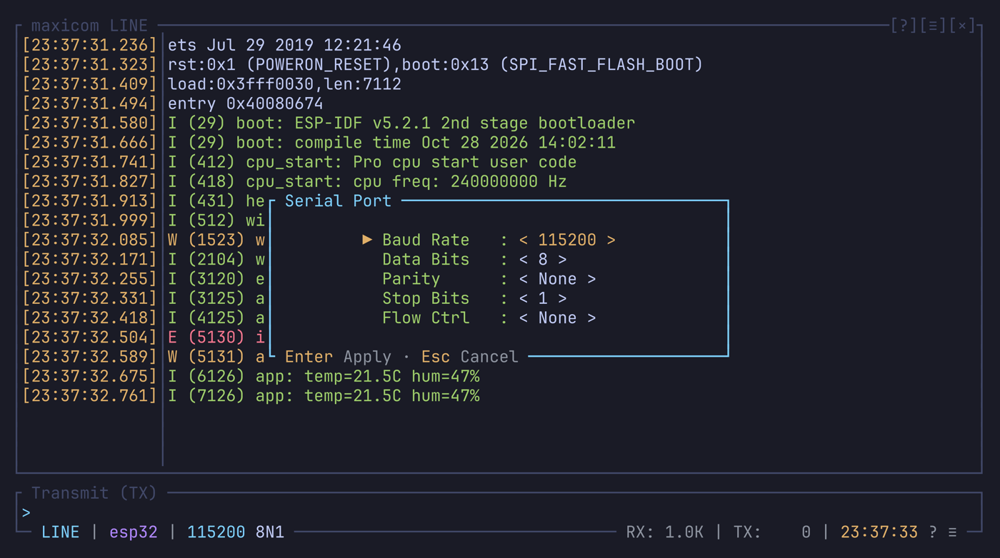

# Links

A link is what maxicom talks to: a serial port, a device over TCP, or the
replay of a recording. This chapter covers opening one, changing its line
settings, and what happens when it goes away.

Related pages:

- [The directory](directory.md): pick a port or a saved link, and test them.
- [Saved links](saved-links.md): open a link by its name.
- [TCP links](tcp-links.md): a device reached over the network.
- [Port locks](locks.md): how maxicom keeps two programs off the same port.

## Opening a link

```text
maxicom [OPTIONS] [LINK | DEVICE]
```

`maxicom --help` lists every option.

### A serial port

```bash
maxicom /dev/ttyUSB0 -b 921600
maxicom COM3
maxicom -D /dev/ttyUSB0 -b 115200
```

The line settings have their own options: `-b, --baudrate`, `--bits`,
`--parity`, `--stop-bits` and `--flow`. An option's value can be glued to
it: `--baudrate=9600`, `-b9600`.

### A device over TCP

```bash
maxicom tcp://192.168.1.50:4000
maxicom --tcp 192.168.1.50:4000
```

See [TCP links](tcp-links.md).

### A saved link

```bash
maxicom esp32
maxicom esp32 -b 9600    # the options win over the saved settings
```

The link opens with its saved line settings, and options you give override
them. See [Saved links](saved-links.md).

maxicom looks for a saved name before a device. When a path is also the name
of a saved link, use `-D`: it always means a device.

### A recording

`maxicom --replay <path>` (or `file://<path>`) plays a recording in place of
a device. See [Replay](capture.md#replay).

### Other startup options

| Option | Does |
| --- | --- |
| `-C, --capturefile <path>` | Records the received text to that file from the start |
| `-H, --displayhex` | Opens the raw side panel in hex |
| `-R, --remotecharset <enc>` | Reads the received bytes as `utf8`, `ascii`, `cp437` or `latin1` |
| `--restore`, `--no-restore` | Restores the last session without asking, or never |

### With no device given

maxicom takes the device from `[link]` in `config.toml` (see
[Default link](#default-link)). When that is empty too, it starts on the
[directory](directory.md) with nothing open, and you pick a link there.

If you close the directory without picking one, a "No device" popup asks you
to pick one (Enter) or quit (Esc). With no saved link and no serial port at
all, maxicom stops and tells you how to give a device.

## Switching links

Open the [directory](directory.md) with `Ctrl-a d` and pick another port or
saved link, or use `open` from the [command line](command-line.md):

```text
open esp32
open /dev/ttyUSB1
open tcp://192.168.1.50:4000
```

Switching to another device clears the screen and brings back that device's
last session. See [Restore](capture.md#restore).

## Line settings

`Ctrl-a p` opens the line settings popup. A click on the baud rate or the
framing in the status bar opens it too. It sets:

- the baud rate, among the common rates from 9600 to 921600;
- the data bits, the parity and the stop bits;
- the flow control.



Enter applies the changes. For a rate that isn't in the list, use `-b` at
startup or the `baud` command.

A TCP link has no line settings, since its bridge sets them: the popup only
shows its address.

### From the command line

The same settings have commands, for the
[command line](command-line.md) or a key:

| Command | Sets |
| --- | --- |
| `baud <rate>` | The baud rate, from 50 to 4000000, if the adapter takes it: `baud 250000` |
| `framing <8N1>` | The data bits (5 to 8), the parity (`N`, `E`, `O`) and the stop bits (1, 2): `framing 7E1` |
| `flow none\|hw\|sw` | The flow control |

On a detached port, they are kept for when it opens. A TCP link and a replay
refuse them.

## Detach and attach

`Ctrl-a D` detaches the link: maxicom closes the port but keeps the screen.
Another program can then use the port, a flasher or another terminal.
`Ctrl-a D` again opens it.

If the reattach fails, for example because another program took the port in
the meantime, the link stays detached and its popup stays up. maxicom doesn't
keep retrying behind your back.

## When a port goes away

A port that is unplugged shows "Connection Lost". maxicom opens it again by
itself when it comes back, and the popup goes away.

## Idle links

A link that receives nothing for `inactivity_detach_timeout` is detached,
with a warning. This way a board forgotten on a desk doesn't hold its port
for days. `Ctrl-a D` attaches it again.

The setting is in `config.toml`. The default is `"4h"`, and `"0s"` turns it
off.

## The link's popups

While a link is detached, lost, or not picked yet, a popup says so:

| Popup | Enter | `d` | Esc |
| --- | --- | --- | --- |
| Detached | Attaches the link again | Opens the directory | Quits maxicom |
| Connection Lost | Quits maxicom | Opens the directory | Quits maxicom |
| No device | Opens the directory | | Quits maxicom |

You don't have to answer a "Connection Lost": the link comes back by itself
when the device does.

The popup comes back whenever a popup opened on top of it closes, so you
don't lose track of the link's state.

## Default link

The `[link]` section of `config.toml` gives the device and line settings
used when you don't give them on the command line. It is read at startup,
and options override it.

```toml
[link]
device = ""        # empty: none, a device must be given
baud = 115200
bits = 8
parity = "none"    # none, even, odd
stop_bits = 1
flow = "none"      # none, rtscts, xonxoff
```

- `device` can also be the name of a saved link.
- There is no default device: a port's name depends on the adapter
  (`/dev/ttyUSB0`, `COM3`, `/dev/cu.usbserial-XXXX`).
- Flow control is off by default, because most USB-UART boards don't wire
  the RTS and CTS lines.
