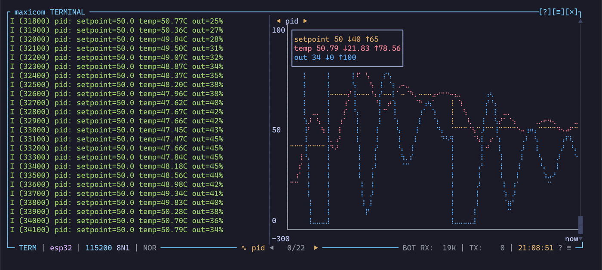

# Plots

A plot charts the numbers your device prints, live, next to the text. If
your firmware prints `temp=23.4 hum=51` every second, a plot draws `temp`
and `hum` as two lines, with their last, lowest and highest values.



The plot takes the [raw side panel](raw-side-panel.md)'s place: the side
shows the bytes or a plot, not both. It only reads what comes in. It never
sends anything, and it doesn't change the history, the recordings or the
session backups.

## Showing a plot

Plots are defined in `plots.toml`, each one with a name. The default file
has four, described in [The default plots](#the-default-plots).

| Key or command | Does |
| --- | --- |
| `Ctrl-a g`, `plot` | Shows the next plot, in the file's order; off after the last |
| `plot <name>` | Shows that plot. The names complete. |
| `plot off` | Hides the plot, the raw side panel comes back |
| `plot-next` / `plot-prev` | The next / previous plot; off past the ends (no key by default) |
| `V` in the settings popup | The next plot, as `Ctrl-a g` |

A click on the `◀` or `▶` around the plot's name, at the top of the panel,
shows the previous or next plot.

To start with a plot shown, give its name:

- with `--plot <name>` on the command line;
- or with `plot = "<name>"` at the top of `config.toml`.

A name that isn't in `plots.toml` is said, and the plot stays off. Both are
read at startup only: a reload doesn't switch the plot you're on.

Nothing is parsed while no plot is shown, so a plot costs nothing until you
pick one.

## The file

Each table of `plots.toml` is a plot, named by its table:

```toml
[key-value]
separator = "="
window = "30s"
```

| Field | Default | Means |
| --- | --- | --- |
| `separator` | `"="` | The text between a key and its value: `=`, `:`, `->`, `=>`, anything |
| `keys` | every key | Only these series, in this order: `keys = ["temp", "hum"]` |
| `columns` | `false` | A line of bare numbers gives series `1`, `2`, `3`... |
| `line_contains` | every line | Only read the lines with this text: `line_contains = "PID"` |
| `window` | `"30s"` | The X axis: a duration, or a number of samples. See [The X axis](#the-x-axis). |
| `min`, `max` | autoscale | A fixed Y range. See [The Y axis](#the-y-axis). |
| `colors` | the link colors | A color per series: `colors = { temp = "Red", hum = "#00A0FF" }` |

`plots_path` in `config.toml` points to another file. `Ctrl-a r` reloads
it.

A plot named `off` isn't allowed, since `plot off` hides the plot.

## Reading the numbers

A line is read once it's complete, at its CR or LF. Each pair is a key, the
separator, then a number:

| The device prints | With `separator` | The plot reads |
| --- | --- | --- |
| `temp=23.4 hum=51` | `"="` | `temp` 23.4, `hum` 51 |
| `temp = 23.4, hum = 51` | `"="` | The same: spaces around the separator are fine |
| `I (4125) app: temp:21.4C hum:48%` | `":"` | `temp` 21.4, `hum` 48: a unit stuck after the number is left out |
| `err -> -1.5e3` | `"->"` | `err` -1500 |
| `mode=auto rssi=-67` | `"="` | `rssi` -67: `auto` isn't a number, the rest of the line is still read |

More precisely:

- The key is the word just before the separator: letters, digits, `_` and
  `.`. In `[pid]err=5`, the key is `err`.
- The number has an optional sign, decimals and an exponent. Hex like
  `0x1F` isn't read.
- When a key comes twice in a line, the first one counts.
- The bytes are decoded with the [encoding](encoding-and-newlines.md#text-encoding)
  in use.

### Bare numbers

With `columns = true`, a line made only of numbers, separated by commas,
spaces or tabs, gives a series per column, named `1`, `2`, `3`...:
`23.4, 51` or `23.4 51`. A unit isn't allowed there: the line is then read
as pairs instead.

This is the format of the Arduino IDE's serial plotter, which also takes
`temp:23.4,hum:51`: the default `arduino` plot reads both.

### Only some lines

`line_contains` skips every line that doesn't have its text, which helps when
several modules print the same keys. The text is matched as written, case
included.

### The series

Without `keys`, each new key found makes a new series, up to 8. With `keys`,
the plot has those series from the start, in that order, and ignores the
other keys. A bare column is named by its number, so `keys = ["2"]` keeps
the second column only.

## The X axis

`window` picks what the X axis is:

| `window` | The X axis |
| --- | --- |
| A duration: `"30s"`, `"2m"` | Time. The chart shows the last 30 s, each point at the time its line arrived. |
| A number: `500` | Samples. The chart shows the last 500 lines that gave a number, as the Arduino plotter does. |

The axis is labelled from `-30s` (or `-500`) to `now`. A window not full yet
fills from the right.

In a replay, the time is the time the replay plays the line at.

## The Y axis

Without `min` and `max`, the Y axis fits the values shown. With both, it is
fixed. With only one, that side is fixed and the other fits the values. A
flat line gets a little room around it.

## The chart

Each series is a line in braille dots, in its color: its own from `colors`,
else the next one of the theme's link colors. The [colors](theme.md#colors)
are written as in the theme.

The legend, in the top left corner, shows each series with its last value
shown, its lowest `↓` and its highest `↑`. It hides when the panel is too
small for it.

Before a number comes in, the panel says which format it waits for.

## Freezing the chart

`Ctrl-a G` (`plot-freeze`) freezes the chart, to read it while the data
goes on. `frozen` shows after the plot's name. The plot still collects what
comes in: `Ctrl-a G` again jumps back to now, with everything received in
between.

## When the plot starts over

The plot empties when you switch to another device, when a replay starts or
starts over, and when a replay stops and the live link comes back. It stays
shown.

What it reads:

- the live data;
- a replay, as it plays;
- not a restored session: its lines would come with old times.

## Size and position

The plot uses the raw side panel's `split_percent` and `orientation`, its
border drag and its resize keys. See
[Size and position](raw-side-panel.md#size-and-position).

The panel needs 50 columns on the right, or 12 rows at the bottom. When the
room is short, a notice says so and the panel is hidden.

## In the status bar

`∿ pid` shows the plot shown, in the warning color while it's frozen. A
click on it freezes or unfreezes the chart.

In your own [status bar](status-bar.md) template:

- `{plot}` is the plot's name, empty when none is shown;
- `plot` is the condition "a plot is shown", and `frozen` "the chart is
  frozen".

## The default plots

| Plot | Reads | Shows the fields |
| --- | --- | --- |
| `key-value` | Every `key=value` pair of every line, over 30 s | `separator`, a duration `window` |
| `arduino` | `temp:23.4,hum:51` or bare `23.4 51`, the last 500 samples | `columns`, a number `window` |
| `sensors` | `temp` and `hum` only, from 0 to 100, over 5 minutes | `keys`, `min` / `max`, `colors` |
| `tagged` | Only the lines with `[plot]`, such as `[plot] err=-1.5 out=40` | `line_contains` |

A quick way to plot from your own firmware is to print a tagged line:

```c
printf("[plot] err=%.2f out=%d\n", err, out);
```

## Limits

- A series keeps 50,000 points at most, whatever its window.
- A line longer than 4096 bytes is skipped.
- A key is a word: a quoted key like `"temp": 23.4` isn't read.

## Errors and reloads

A plot that can't draw anything stops the file from loading, naming the
plot: an empty `separator` or `line_contains`, a `window` of 0, `min` not
below `max`, more than 8 `keys`. A misspelt field is said in a warning, and
takes its default.

On a reload, the plot shown keeps its points while its definition is the
same. When it changed, the plot starts over. When it's gone from the file,
the plot turns off and a notice says so.
