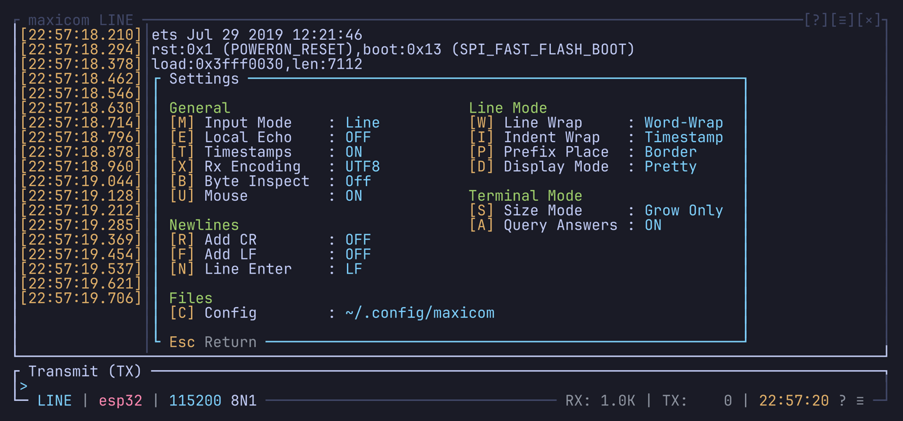

# Popups

Most of maxicom's tools open in a popup over the history: the help, the
settings, the directory, the dialogs that ask for a name or a path. They all
share the same keys, described once here. The other chapters only list the
keys a popup adds.

## Moving around

| Key | Does |
| --- | --- |
| `Up` `k` / `Down` `j` | Move up / down |
| `Left` `h` / `Right` `l` | Change a value, or switch tab |
| `Home` `g` / `End` `G` | First / last item |
| `PageUp` `Ctrl-u` / `PageDown` `Ctrl-d` | A page up / down |
| `Tab` `Space` `Ctrl-n` / `Shift-Tab` `Ctrl-p` | Next / previous field, value or tab |
| `Enter` | Apply, open, confirm |
| `Esc` `q` | Close |

These are the `[dialog_actions]` of `keymap.toml`, so you can change them
there. See [Keybindings](keybindings.md#dialog_actions).

## Text fields

In a popup where you type text (a name, a path), only Enter, Esc, Tab and
Shift-Tab keep their popup meaning. The other keys edit the text, so `j` or
`q` are typed as letters.

## Keys of their own

Some popups add keys, or give a key another meaning: in the trigger browser,
Space toggles a trigger rather than moving on. Each chapter lists these
keys, under "On top of the popup keys".

## The mouse

A click selects a row, a field, a tab or a button. In the lists (the
directory, the triggers), a click on the row already selected acts like
Enter. Fields drawn with arrows change their value when you click an arrow.

## Questions

When maxicom asks a yes / no question (quit, delete, restore a session),
Enter or `y` answers yes, Esc or `n` answers no.

## Error popups

An error you need to read, like a config file that doesn't load, opens in a
popup with the details. Esc or Enter closes it.

## The popups

| Popup | Key | Chapter |
| --- | --- | --- |
| Help | `Ctrl-a ?`, `Ctrl-a z` | [Settings](settings.md#help) |
| Settings | `Ctrl-a o`, `Ctrl-a s` | [Settings](settings.md#the-settings-popup) |
| Directory | `Ctrl-a d` | [The directory](directory.md) |
| Saved link form | `n`, `e` or `s` in the directory | [Saved links](saved-links.md#editing-in-the-app) |
| Line settings | `Ctrl-a p` | [Links](links.md#line-settings) |
| Terminal size | `Ctrl-a W` | [Terminal mode](terminal-mode.md#setting-the-size-by-hand) |
| Recording | `Ctrl-a l` | [Capture](capture.md#starting-a-recording) |
| Screenshot | `Ctrl-a k`, `Ctrl-a K` | [Capture](capture.md#screenshots) |
| Session browser | `Ctrl-a j` | [Capture](capture.md#session-browser) |
| Triggers | `Ctrl-a T` | [Triggers](triggers.md#the-trigger-browser) |
| Command line | `Ctrl-a :` | [Command line](command-line.md) |
| Right-click menu | A right click | [Copy mode and mouse](copy-mode-and-mouse.md#right-click-menu) |
| Detached, Connection Lost, No device | Shown by the link | [Links](links.md#the-links-popups) |
