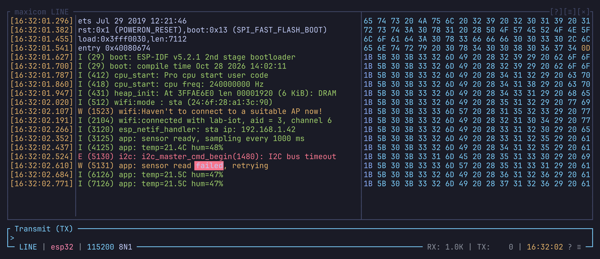

# Raw side panel

The raw side panel shows the received bytes next to the text. In line mode
they are the bytes as they came off the wire, so it reveals what the
decoding and the colors hide: a stray `\r`, a `0x00`, a framing problem. In
terminal mode it shows less, see [In terminal mode](#in-terminal-mode).

A [plot](plots.md) shows at the bottom, under this panel; set to the same side,
it takes the panel's place while one is shown.

## Showing it

`Ctrl-a B`, or `B` in the settings popup, cycles `view` in `[raw_side]`:

| View | Shows each byte as |
| --- | --- |
| `off` (default) | The panel is hidden |
| `hex` | Hexadecimal |
| `octal` | Octal |
| `binary` | Bits |

`-H` at startup opens it in hex. A right click on the panel offers Close raw
panel, which turns it off.

## Reading it

The panel follows the history: its rows are the same lines, so a line and
its bytes stay side by side as you scroll.

### In terminal mode

In line mode, each row shows the line's bytes exactly as received. In
terminal mode, the bytes go through the emulator first, and the panel shows
each screen row rebuilt from what is left on it. So some bytes never show:

| The device sent | The panel shows | Why |
| --- | --- | --- |
| `abc`, CR, `XY`, CR LF | `XYc` | CR and LF move the cursor; `XY` wrote over `ab` |
| `ESC [ 1 ; 32 m ok` | `ESC [ 32 ; 1 m ok` | The colors are written again by the emulator, not copied |
| `café`, `ESC [ 2 K`, `gone` | `ESC [ 5 C gone` | The erase removed `café`; the gap comes back as a cursor move |
| `ESC ] 0 ; title`, BEL | Nothing | A window title isn't drawn on the screen |

In terminal mode, the panel also shows:

- the text after its decoding to UTF-8: with the `latin1` encoding, a
  received `E9` (`é`) shows as `C3 A9`;
- nothing of the queries, cursor moves and other control sequences, which act
  on the screen instead of drawing on it.

To see every byte the device sent, switch to line mode (`Ctrl-a m`). It has
the same data, as long as `dual_mode_buffering` is `"always_both"`, the
default (see [Two modes](introduction.md#two-modes)).

Bytes are colored by kind, from `[raw_inspector]` in the theme:

| Entry | Bytes |
| --- | --- |
| `byte_ascii` | Printable ASCII |
| `byte_whitespace` | `\n`, `\r`, `\t` |
| `byte_null` | `0x00` |
| `byte_ones` | `0xFF` |
| `byte_sync` | The sync bytes `0x55`, `0xAA`, `0x7E` |
| `byte_other` | Everything else |

When its rows are wider than the panel, `Ctrl-a Shift-Left` /
`Ctrl-a Shift-Right` pan it.

## Copying and searching bytes

- In [copy mode](copy-mode-and-mouse.md#copy-mode), Tab moves the cursor
  into the panel to select bytes.
- `Y` copies a selection's bytes as the panel shows them.
- A [byte search](search.md#byte-search) takes bytes written in the panel's
  current view.

## Size and position

| Setting in `[raw_side]` | Default | Does |
| --- | --- | --- |
| `split_percent` | `40` | The share of the room it takes, 10 to 85 |
| `orientation` | `"right"` | Where it sits: `right` or `bottom` |

To resize it while maxicom runs:

- drag its border with the mouse;
- `Ctrl-a >` / `Ctrl-a <` grow or shrink it by 5 %;
- the actions `side-grow` / `side-shrink` do it by 1 %, for a key you bind.

The new size lasts until you quit; `config.toml` keeps its value.

A [plot](plots.md#size-and-position) has its own place and size, `[plot_side]`.
