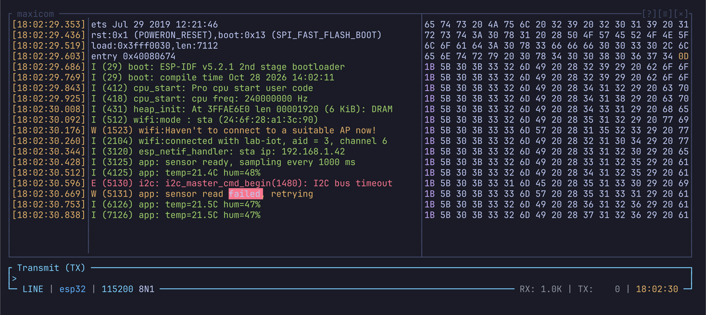

# Raw side panel

The raw side panel shows the bytes as they came off the wire, next to the
text. It reveals what the decoding, the colors and the screen hide: a stray
`\r`, a `0x00`, an escape sequence, a framing problem. Line mode shows each
line next to its bytes; terminal mode shows every byte received in a dump,
see [In terminal mode](#in-terminal-mode).

A [plot](plots.md) shows at the bottom, under this panel; set to the same side,
it takes the panel's place while one is shown.



## Showing it

`Ctrl-a B`, or `B` in the settings popup, cycles `view` in `[raw_side]`:

| View | Shows each byte as |
| --- | --- |
| `off` (default) | The panel is hidden |
| `hex` | Hexadecimal |
| `octal` | Octal |
| `binary` | Bits |

`-H` at startup opens it in hex. A right click on the panel offers Close raw
panel, which turns it off.

## Reading it

### In line mode

The panel follows the history: its rows are the same lines, so a line and
its bytes stay side by side as you scroll. The keys that scroll terminal
mode's dump scroll them both: `Ctrl-a Shift-Up` / `Ctrl-a Shift-Down` a row,
`Ctrl-a Shift-PageUp` / `Ctrl-a Shift-PageDown` a page.

### In terminal mode

The screen doesn't keep the bytes that drew it: CR and LF move the cursor,
text gets written over, an erase or a window title leaves nothing behind.
So in terminal mode the panel shows every byte received, in the order it
came, as a dump like `xxd`'s:

```text
00000000  1B 5B 33 32 6D 6F 6B 1B 5B 30 6D 0D 0A 24 20 F1  .[32mok.[0m..$ .
00000010  0D 0A                                            ..
```

- The offset of the line's first byte, in hex. It stays in place when the
  panel pans.
- The bytes, in the panel's view.
- Their text: printable ASCII as is, every other byte `.`.

Every line holds the same number of bytes, the most that fit the panel's
width in groups of 8, at least 8. When even 8 don't fit, as often in binary,
`Ctrl-a Shift-Left` / `Ctrl-a Shift-Right` pan it.

The dump scrolls on its own, apart from the screen:

- the wheel over it, or its own scrollbar in its right column;
- `Ctrl-a Shift-Up` / `Ctrl-a Shift-Down`, a line, and
  `Ctrl-a Shift-PageUp` / `Ctrl-a Shift-PageDown`, a page. The prefix stays
  between them: `Ctrl-a` once, then `Shift-Up` as many times as needed, see
  [The prefix](keybindings.md#the-prefix);
- in copy mode with the cursor in it, `Ctrl-y` / `Ctrl-e`, the cursor
  staying.

It follows the bytes coming in while it shows its last line, and goes back to
them when the screen goes back live: a key typed, the screen scrolled back
down to its end.

A dump line and the screen row next to it aren't the same text: one byte can
redraw a row far up, and a progress bar writes the same row again and again.
In copy mode, [the byte trace](#the-byte-trace) shows which bytes drew which
cell.

maxicom keeps the bytes of the last `terminal_mode.history_size` × 512
bytes (51 MB with the default), the oldest dropped first.

Bytes are colored by kind, from `[raw_inspector]` in the theme:

| Entry | Bytes |
| --- | --- |
| `byte_ascii` | Printable ASCII |
| `byte_whitespace` | `\n`, `\r`, `\t` |
| `byte_null` | `0x00` |
| `byte_ones` | `0xFF` |
| `byte_escape` | `0x1B`, the ESC starting escape sequences |
| `byte_sync` | The sync bytes `0x55`, `0xAA`, `0x7E` |
| `byte_other` | Everything else |

When its rows are wider than the panel, `Ctrl-a Shift-Left` /
`Ctrl-a Shift-Right` pan it.

## Copying and searching bytes

In [copy mode](copy-mode-and-mouse.md#copy-mode), Tab moves the cursor into
the panel to select bytes, and back. In terminal mode it lands on the
[byte trace](#the-byte-trace)'s ghost when there is one. A [byte search](search.md#byte-search)
takes bytes written in the panel's current view.

In line mode, the cursor moves along the line's bytes and `Y` copies a
selection's bytes as the panel shows them.

In terminal mode, the cursor moves in the dump, a byte at a time:

| Keys | Do |
| --- | --- |
| `h` `l`, Left Right | The byte before / after |
| `j` `k`, Down Up | The same byte a line down / up |
| `0` `^` / `$` | Start / end of the line |
| `gg` / `G` | The first / last byte kept |
| `Ctrl-u` `Ctrl-b` / `Ctrl-d` `Ctrl-f`, PageUp / PageDown | A page up / down |
| `v` / `V` | Select bytes / whole lines |
| `Ctrl-y` / `Ctrl-e` | Scroll the dump a line; the cursor stays |
| `y` or Enter | Copy the selection as the panel shows it, in its view |
| `Y` | Copy the selection's bytes as received, read as UTF-8 |

The mouse selects in the dump as on the screen: drag over the bytes or their
text, and the release copies. Held past the panel's edge, the drag scrolls
the dump.

A byte search goes over every byte kept, and finds what the screen doesn't
show, as an `F1` drawn `�`. Its matches are marked in the dump, and `n` /
`N` move the dump's cursor to them, even when the search started on the
screen. A text search moves the screen's cursor. With the panel off, a byte
search finds nothing and says so.

## The byte trace

In terminal mode, maxicom remembers which received bytes drew which cell of
the screen: the byte trace. In [copy mode](copy-mode-and-mouse.md#copy-mode),
each panel shows where the other one's cursor is.

With the cursor on the screen, the dump shows the bytes behind the cursor's
cell:

| Look | Bytes |
| --- | --- |
| `cursor_ghost` | The char the cell shows: the last one written there |
| `cursor_ghost_old`, dimmer | The chars written there before, up to 32: a progress bar writes the same cells again and again |

With the cursor in the dump, the screen shows the cell its byte drew:

| Look | Cell |
| --- | --- |
| `cursor_ghost` | It still shows that byte's char |
| `cursor_ghost_old`, dimmer | Something was written over it since |

A byte that draws nothing, a control byte or part of an escape sequence, has
no cell.

When the cursor moves, the other panel keeps its ghost in the middle half of
what it shows: it stays still while the ghost is there, and centers it when
it would leave. Bytes coming in don't move it back, and a panel scrolled by
hand stays until the cursor moves again. Tab puts the cursor on its ghost:
from the screen on the bytes the cell shows, from the dump on the cell its
byte still shows.

A selection shows in the other panel too, in its own look:

- selected on the screen, the dump shows the bytes that make it: the
  selected chars' bytes and what lies between them that draws nothing, the
  colors and the line ends, but not bytes that drew other text;
- selected in the dump, the screen shows the cells those bytes drew,
  `cursor_ghost_old` where something was written over them.

`Y` on a screen selection copies the bytes the dump shows for it, as the
panel shows them, in hex when the panel is closed: the trace is kept either
way. Without a trace for it (the trace off, its bytes dropped or moved), `Y`
copies the bytes the screen rebuilds from its cells instead: the text and its
colors, but not the bytes received, and maxicom warns so.

A cell shows no bytes when nothing traced drew what it shows now:

- it's blank, or erased;
- its bytes were dropped, past the bytes kept (see
  [In terminal mode](#in-terminal-mode));
- a full-screen program moved its text: a scroll region, inserted or deleted
  lines, or the alternate screen scrolling. maxicom shows no bytes rather
  than wrong ones. For the same reason, a byte whose text moved shows its
  old cell, as written over.

The trace takes up to 256 bytes per `terminal_mode.history_size` row (about
25 MB with the default) and some time on a fast link: a TCP link or a replay
flooding maxicom. `Y` in the settings popup, `set byte-trace on|off`, or
`byte_trace = false` in `[terminal_mode]` turns it off: nothing is recorded
and the memory is given back. Turned on again, it traces the bytes received
from then on.

## Size and position

| Setting in `[raw_side]` | Default | Does |
| --- | --- | --- |
| `split_percent` | `40` | The share of the room it takes, 10 to 85 |
| `orientation` | `"right"` | Where it sits: `right` or `bottom` |

To resize it while maxicom runs:

- drag its border with the mouse;
- `Ctrl-a >` / `Ctrl-a <` grow or shrink it by 5 %;
- the actions `side-grow` / `side-shrink` do it by 1 %, for a key you bind.

The new size lasts until you quit; `config.toml` keeps its value.

A [plot](plots.md#size-and-position) has its own place and size, `[plot_side]`.
