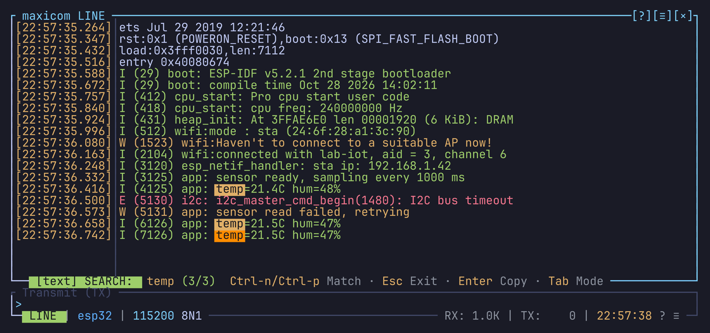

# Search

A search finds text or bytes in the history and moves the
[copy mode](copy-mode-and-mouse.md#copy-mode) cursor to them. It works in
both modes.

## Starting a search

| Key | Starts |
| --- | --- |
| `Ctrl-a /` | A search forward, down the history |
| `Ctrl-a ?` | A search backward, up the history |
| `/` in copy mode | A search forward, from the cursor |
| `?` in copy mode | A search backward, from the cursor |

Search in the right-click menu does the same as `Ctrl-a /`.

A search always runs in copy mode. `Ctrl-a /` and `Ctrl-a ?` enter copy mode
first, at the bottom of the view, then open the search bar over the bottom
of the history. From the live view, `Ctrl-a ?` finds the newest match and
`Ctrl-a /` the oldest. The bar shows the search as you'd type it in vi,
`/` for a search forward and `?` for a search backward, after the kind:
`[text] /error (3/12)`. Past 1000 matches, the count reads `1000+`.

## Typing the search

The bar opens empty, with your last search dimmed in it. Enter on the empty
bar searches it again; type to search something else.

Type the text: every match lights up as you type, and the current one
stands out. The copy mode cursor follows the current match, and the view
with it. The bar shows the current match's number and the count. Up to
1000 matches are found.

The first match is the one after the cursor for a search forward, and the
one before it for a search backward. When there is none that way, the
search goes on from the other end of the history. A match right on the
cursor is skipped.

| Key | Does |
| --- | --- |
| Ctrl-n / Ctrl-p | Next / previous match, down / up the history |
| Enter | Close the bar, the cursor on the current match |
| Esc | Close the bar |
| Tab | Switch between a text search and a byte search |
| Up / Down | An older / newer search in place of what you typed, among those starting with it |

The last 100 searches you ran with Enter are kept, for both modes, until
maxicom quits.

Esc takes you back to where you started, and keeps your last search for `n`
and `N`: what you typed is dropped. A search started with `Ctrl-a /` or
`Ctrl-a ?` leaves copy mode for the live view. One started in copy mode puts
the cursor back where it was, your selection kept.

## Going through the matches

After Enter, you stay in copy mode. The matches stay lit and the bar stays in
the bottom border, showing the search, the current match and the keys to go
through the matches. They go away when you leave copy mode.

| Key | Does |
| --- | --- |
| `n` | Next match, in the search's direction |
| `N` | Next match the other way |
| `/` / `?` | A new search forward / backward from the cursor |

`n` and `N` start from the cursor, so they also work after you moved it.
They move the cursor without dropping a selection: start one with `v`, then
`n` to stretch it to the next match. Going past the last match goes on from
the other end of the history, and a notification says so.

In copy mode, `n` also brings back the matches of your last search after you
left copy mode.

## Text search

A text search ignores the case of ASCII letters: `error` finds `ERROR`.
Other characters must match exactly.

It searches what is on display: in line mode, the lines in their current
display mode; in terminal mode, the screen and the scrollback.

## Byte search

A byte search looks for bytes in the received data. Write them the way the
[raw side panel](raw-side-panel.md) shows them:

| Panel view | Examples |
| --- | --- |
| hex (default) | `0d0a`, `0d 0a`, `0x0d 0x0a`, `\x0d\x0a` |
| octal | `015 012` |
| binary | the bits of each byte |

## From the command line

`search <text>` on the [command line](command-line.md) starts a search forward
for that text, the bar open on it. Bind it to a key for a search you use
often.

## Colors

The `[search]` section of `theme.toml`: `search_match` for the matches,
`search_match_active` for the current one, and `search_indicator` for the
bar's label.
