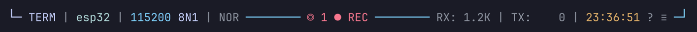

# Status bar

The status bar is built from three templates, `left`, `center` and
`right`, in the `[ui.status_bar]` section of `config.toml`. They are written
in a small language of text, variables and styled blocks, so you can change
what the bar shows, its colors, and what a click on it does. `Ctrl-a r`
applies a change.



## A first example

```toml
[ui.status_bar]
left = "[ {mode} ](bg=main fg=black bold) {port} [{baud}](primary)"
```

This shows the mode in a colored badge, the port as plain text, then the
baud rate in the accent color. Every part of the bar is built this way.

## Syntax

| Write | For | Example |
| --- | --- | --- |
| `plain text` | Text in the bar's base style (`status_bar` in the theme) | `RX:` |
| `{variable}` | A value maxicom fills in, see [Variables](#variables) | `{baud}` |
| `[content](style)` | Text and variables in a [style](#styles) | `[{baud}](primary)` |
| `[content](cond?yes:no)` | A style picked by a [condition](#conditions) | `[REC](rec?warn:hide)` |
| `(style1 style2)` | Several style items grouped, in a condition's branch | `rec?(fg=warn bold):hide` |
| `\` at the end of a line | Joins the next line, its indentation dropped | see below |

Plain text sits on the UI background, unless the layout is `band`.

## Several lines

A long template reads better with one block per line, each line but the
last ending with `\`.

Use a `'''` string: TOML keeps the `\` and the status bar joins the lines.
(In a `"""` string, TOML joins the lines itself.) The default config file is
written that way:

```toml
right = '''
[{scroll_pos_up} ](has_scroll?muted:hide prio=2)\
    [RX: {rx_bytes:4h}](muted prio=3)\
    [ | ](muted prio=3)\
    ...'''
```

The next line's indentation is dropped, but a space before the `\` stays,
as between `[{time}](...)` and `[?](...)` below.

## The default

```toml
[ui.status_bar]
left = '''
[ {mode} ](prefix?(bg=secondary fg=black bold):copy_raw?(bg=selection_raw fg=black bold):copy?(bg=selection fg=black bold):search?(bg=search fg=black bold):(fg=primary bold))\
    [|](muted prio=3)\
    [ {port}](link prio=3)\
    [ |](muted prio=3)\
    [ ](prio=2)\
    [{baud}](primary prio=2)\
    [ ](prio=4)\
    [{framing}](prio=4)\
    [ |](term?muted:hide prio=4)\
    [ {cursor_keys}](term?muted:hide prio=4)'''
center = '''
[◎ {trigger_count} ](armed?(fg=warn bold):hide)\
    [⟳ mash ](mashing?(fg=secondary bold):hide click=cancel)\
    [⇡ {send_file} {send_percent:>3}% ](sending?(fg=secondary bold):hide)\
    [▷ {replay_state} {replay_percent:>3}% ](replaying?(fg=secondary bold):hide prio=5)\
    [« live](replaced?(fg=main bold):hide click=toggle-attach)\
    [+CR](add_cr?(fg=warn bold):hide click=toggle-add-cr)\
    [+LF](add_lf?(fg=warn bold):hide click=toggle-add-lf)\
    [● REC ](rec?(fg=warn bold):hide click=record)\
    [◀ ](wide?(pan_left?secondary:muted):hide click=pan-left)\
    [{pan_offset:>3}/{pan_max:<3}](wide?muted:hide)\
    [ ▶](wide?(pan_alert?(fg=warn bold):(pan_right?secondary:muted)):hide click=pan-right)'''
right = '''
[{scroll_pos_up} ](has_scroll?muted:hide prio=2)\
    [RX: {rx_bytes:4h}](muted prio=3)\
    [ | ](muted prio=3)\
    [TX: {tx_bytes:4h}](muted prio=3)\
    [ | ](muted prio=4)\
    [{time}](secondary prio=4) \
    [?](muted click=help hover=(bg=primary fg=black)) \
    [≡](muted click=settings hover=(bg=secondary fg=black)) '''
time_format = "%H:%M:%S"
hover = "reversed"
layout = "border"
```

## Variables

| Variable | Value | Example |
| --- | --- | --- |
| `{mode}` | `TERM` or `LINE`, `COPY` while copy mode is on | `TERM` |
| `{port}` | Device address, or a saved link's name | `/dev/ttyUSB0`, `tcp://192.168.1.50:4000`, `esp32` |
| `{baud}` | Baud rate; `raw` for a raw TCP link | `115200` |
| `{framing}` | Serial framing; `TCP` for a TCP link | `8N1` |
| `{rx_bytes}` / `{tx_bytes}` | Received / transmitted bytes count | `1024` |
| `{time}` | Local time, in `time_format` | `21:45:00` |
| `{pan_left}` / `{pan_right}` | Left / right pan amount | `◀ (3)`, `!(2) ▶` |
| `{pan_offset}` | Columns panned from the left edge | `3` |
| `{pan_max}` | Columns the view can pan in all | `117` |
| `{scroll_pos}` / `{scroll_pos_up}` | Position: `All`, `Bot`, `Top`, `42%` / uppercase | `BOT` |
| `{scroll_percent}` | Numeric percent: 0..100 | `42` |
| `{scroll_offset}` | Lines scrolled away from tail | `15` |
| `{scroll_max}` | Total scrollback depth | `500` |
| `{copy_side}` | The copy cursor's panel, `TXT` or `RAW`, empty out of copy mode | `RAW` |
| `{cursor_keys}` | The cursor keys mode the remote set, `NOR` or `APP` (application: the arrows send `ESC O A`), empty in line mode | `APP` |
| `{send_file}` / `{send_percent}` | The file `send-file` sends (empty when none) / how much is sent, 0..100 | `fw.hex` |
| `{trigger_count}` | How many triggers are armed | `2` |
| `{trigger_names}` | The armed triggers' names | `login, u-boot` |
| `{replay_file}` | The file a replay reads, empty when none | `boot.raw` |
| `{replay_state}` | `RUN`, `PAUSE`, `END`, empty when no replay | `PAUSE` |
| `{replay_percent}` | How much of the file it read, 0..100 | `42` |
| `{replay_read}` / `{replay_size}` | Bytes read / the file's size | `4096` |

The default bar doesn't show `{copy_side}`: in copy mode the mode badge reads
`COPY`, and its color tells the panel instead. To show it, add this block
after `{mode}`'s:

```text
[ {copy_side} ](copy_raw?(fg=selection_raw bold):copy?(fg=selection bold):hide)
```

## Formats

`{name:spec}`, spec `[<>^][0][width][h]`:

| Write | For |
| --- | --- |
| `{rx_bytes:8}` | Pad to 8 columns (numbers right, text left) |
| `{port:<12}` | Align with `<`, `>` or `^` (center) |
| `{rx_bytes:08}` | Pad a number with zeros |
| `{rx_bytes:4h}` | Short size with a unit letter (`1.0K`, `12K`, `1.2M`), 4 columns |

A longer value is never cut; a malformed spec stays as written.

## The pan

The pan position shows in one place only: in the bar when a template uses a
pan variable, otherwise as arrows in the history's bottom border.

The default center part shows it as `◀ offset/max ▶`, padded so it doesn't
move while you pan.

## Conditions

A condition picks the style of a block: `[REC](rec?(fg=warn bold):hide)`
shows `REC` in the warning color while a recording runs, and hides it
otherwise. Conditions chain:
`prefix?(...):copy?(...):(...)`.

| Condition | Aliases | True when |
| --- | --- | --- |
| `prefix` | | The prefix (`Ctrl-a`) is active |
| `line` / `term` | `linemode` / `terminal` | Line / terminal mode |
| `copy` | `copymode` | Copy mode |
| `copy_raw` | `raw_cursor` | The copy cursor is in the raw side panel |
| `search` | | The search bar is open |
| `overlay` | `popup` | A popup is open |
| `focused` | | The window has the desktop's focus |
| `mouse` | | Mouse support is on |
| `rec` | `logging` | A recording runs |
| `session` | `backup` | The session backup runs |
| `line_settings` | `serial` | The link has line settings: a serial port, not a TCP link whose bridge sets them |
| `add_cr` / `add_lf` | | Add CR / add LF is on |
| `app_cursor` | `decckm` | Terminal mode, and the remote turned on the application cursor keys (`APP`) |
| `sending` | `send_file` | A file is being sent |
| `armed` | `trigger` | A trigger is armed |
| `mashing` | `mash` | `mash` is running |
| `replaying` | `replay` | A replay takes the link's place, ended or not |
| `replaced` | `live_behind` | That replay holds a live link's place, which `toggle-attach` (the default bar's `« live`) goes back to |
| `is_live` | `live`, `is_bottom`, `bottom`, `bot` | Following the live output |
| `is_top` | `top` | Scrolled to the top |
| `is_scrolled` | `scrolled`, `paused` | Scrolled up into the history |
| `scroll_up` / `scroll_down` | `can_scroll_up` / `can_scroll_down` | History above / below the view |
| `has_scroll` | | The history is taller than the view |
| `panned` | `pan`, `panning` | The view is panned |
| `pan_left` / `pan_right` | `can_pan_left` / `can_pan_right` | It can pan left / right |
| `pan_alert` | `pan_right_alert` | Unread content to the right |
| `wide` | `pannable` | The content is wider than the view |
| `new_data` | `unread`, `missed` | Data arrived while scrolled up |

## Styles

A block's style is one or more of the items below, separated by spaces:
`[{baud}](primary bold prio=2)`. In a condition, a branch with several items
is grouped in parentheses: `[REC](rec?(fg=warn bold):hide)`.

### Colors

A color alone sets the text color: `[{baud}](primary)`. With `fg=<color>`
and `bg=<color>` you set either one; `fg=none` and `bg=none` clear them.

| Colors | From |
| --- | --- |
| `main` (or `primary`), `secondary`, `ternary`, `text`, `muted`, `warn` (`warning`), `good` (`ok`, `success`), `unselected` | The theme's [palette](theme.md#palette) |
| `selection`, `selection_raw` | The background of `[ui.selection]` / `[ui.selection_raw]`, which the default mode badge takes in copy mode |
| `search` | The background of `[search.search_indicator]`, which the badge takes while searching |
| `match`, `match_active` | The search highlights |
| `border` | The frame's color, for separators that blend into it |
| `bar` | The bar's background |
| `link` | The current link's color, one of `[palette] links`, as in the session browser: `[{port}](link)` |
| `black`, `red`, `green`, `yellow`, `blue`, `magenta`, `cyan`, `gray`, `darkgray`, `white` | Named colors |
| `#RRGGBB` | An exact color |

### Modifiers

`bold`, `dim`, `italic`, `underlined` (`underline`), `reversed` (`reverse`),
`crossed`, `slow_blink` (`sblink`), `rapid_blink` (`rblink`), and `reset`
(`default`).

`hide` (`hidden`, `none`) leaves the block out.

### Mouse

- `click=<action>` runs a keymap action when the block is clicked, for
  example `help`, `settings`, `quit` or `record`.
- `hover=<style>` styles the block while the mouse is over it, for example
  `hover=(bg=main fg=black)`. `hover=none` turns it off.

Blocks without `hover=` take `hover` from `[ui.status_bar]` (default
`"reversed"`, `"none"` for no hover).

`click=` and `hover=` aren't part of the style: they stay the same in both
branches of a condition.

## When it doesn't fit

Give a block `prio=N` to say how important it is, `1` being the most
important. When the bar is too narrow, it tries, in order:

1. the compact forms: `{port}` as `ttyUSB0` (a saved link keeps its name),
   byte counts as `1.2K`, the pan as `◀3`, `{trigger_names}` as the first
   name and how many more;
2. dropping the blocks with the highest `prio`, then the next highest, and
   so on;
3. dropping the center part;
4. cutting the right part from its left.

Blocks without `prio=`, and plain text, always stay.

Blocks with the same `prio` go together, so give a separator the same
`prio` as the block it goes with.

## Clicks

### Default clicks

A block without `click=` runs what its first variable implies:

| Variable | A click |
| --- | --- |
| `{mode}` | Switch between LINE and TERM |
| `{baud}`, `{framing}` | Open the link settings (`{port}` does nothing) |
| `{copy_side}` | Switch the copy cursor's panel |
| `{pan_left}`, `{pan_right}` | Pan left / right |
| `{pan_offset}`, `{pan_max}` | Back to the left edge |
| `{send_file}`, `{send_percent}` | Stop sending the file |
| `{scroll_pos}`, `{scroll_pos_up}`, `{scroll_percent}`, `{scroll_offset}` | Back to the live output |

A variable in plain text, outside `[...]`, is clickable on its own.

### Scroll and pan blocks

`click=` can run these scroll and pan actions: `scroll-up`, `scroll-down`,
`page-up`, `page-down`, `scroll-to-top`, `scroll-to-bottom`, `pan-left`,
`pan-right`, and `pan-home` (back to the left edge).

- They only move the view. In copy mode, the copy cursor stays where it is.
- The step actions (`scroll-up`, `scroll-down`, `page-up`, `page-down`,
  `pan-left`, `pan-right`) repeat while you hold the button on their block,
  until the pointer leaves it.
- The mouse wheel over a block that pans pans the history.

A custom scroll block:

```text
[▲](click=page-up)[{scroll_percent:>3}%](muted)[▼](click=page-down)
```

### The history box's indicators

They react to clicks too:

- the bottom border's `◀ (n)` and `(n) ▶` pan;
- the title's `SCROLL +n` goes back to the live output;
- the title's `PAN +n` goes back to the left edge.

## Layout

`layout` in `[ui.status_bar]` sets where the bar is drawn:

| Layout | Where |
| --- | --- |
| `line` | A row of its own, plain text on the UI background |
| `band` | A row filled with the `status_bar` background |
| `border` (default) | In the bottom border of the last box: the input box in line mode, the history in terminal mode, or the search bar while it's open |
| `box` | In a box of its own, 3 rows high |

`border` and `box` need borders; without them, they fall back to `line`.
With borders on, `line` and `band` are inset by one column on each side.

## Time format

`time_format` (default `"%H:%M:%S"`) is the strftime format of `{time}`.
