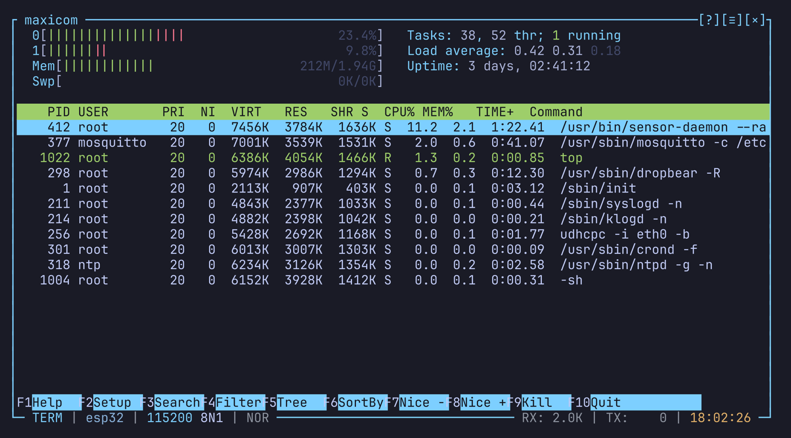

# Terminal mode

Terminal mode is a terminal emulator (VT100 / xterm, through the `vt100`
crate). The device's colors, cursor moves and full-screen programs (vim,
less, top, menuconfig) show as they would in a local terminal.

Every key goes to the device as you type it. Enter sends CR, and the arrows
and function keys send their escape sequences, in the cursor key mode the
program asked for.

Terminal mode is the default (`mode = "terminal"`). `Ctrl-a m` switches to
line mode and back.



## Screen size

The emulated screen has a size of its own, in rows and columns, which can
differ from the view: it's the size a program on the device draws for.

The device doesn't learn this size by itself, because a serial line has no
resize signal (see [Serial shells](#serial-shells) for how to tell it). So
changing it only changes what maxicom can show. The exception is a program
that asks maxicom for [size reports](#size-reports-from-programs): it's told
each new size.

A line wider than the screen wraps at the screen's width. When the screen
gets narrower, the rows on it are cut at the new width. `grow_only` and
`auto` never let that happen to a line, on the screen or in the history.
The other modes can cut long lines.

The default, `auto`, suits most uses: the screen follows the window, never
gets smaller than the size most devices draw for, and never cuts a line.
Lines wrap where you see them, and the screen goes back to the window's
size once wider content is gone.

For a device whose programs draw full screens without the alternate screen
(menus, editors, `top` on a `vt100` or `linux` terminal type), and when you
told the device a bigger size, `grow_only` is the safer choice: the screen
never gets smaller than what was drawn for it. It costs memory and speed
after the window was made bigger, even for a moment, as every line keeps
the widest size.

### Dimension mode

`dimension_mode` in `[terminal_mode]` decides how the screen is sized. `S`
in the settings popup cycles it.

| Mode | Size | Can cut long lines |
| --- | --- | --- |
| `auto` (default) | The view's size, but never smaller than `rows` x `cols`, the content below the cursor or the widest row on the screen. When history lines wider than the screen come back on it (the window got taller), the screen widens for them first. While a full-screen program uses the alternate screen, the size stays as it is. | No |
| `grow_only` | Grows with the view, never shrinks. When the window gets smaller, the view follows the cursor. | No |
| `match_view` | Like `auto`, but history lines wider than the screen are cut when they come back on it. | Yes, in the history |
| `fixed_cols` | The view's rows, but never fewer than the content below the cursor; `cols` columns | Yes |
| `fixed` | `rows` x `cols` | Yes |

Picking `match_view` in the settings popup shows a warning, as it can cut
lines in the history.

History lines that are wider than the screen can still be read: the view
pans to them, and search, copy and highlights see them whole.

`rows` and `cols` in `[terminal_mode]` (default `24` x `80`) give the size
of `fixed`, the columns of `fixed_cols`, and the smallest size of `auto`.
They are read at startup.

`auto` doesn't go below that size so that lines stay readable in a narrow
window: they wrap at 80 columns and the view pans to the rest. It's also
the size most devices draw for. The columns count the history's borders
and scrollbar, so in a window of exactly 80 columns the screen is the
view, and there is nothing to pan.

`auto` holds its size during a full-screen program (an editor, `top`, a
menu) that uses the alternate screen. The lines of the normal screen wait
behind it, and they would be cut if the screen got smaller then. Once the
program ends, the screen follows the view again.

### Setting the size by hand

`Ctrl-a W` (or Terminal size in the right-click menu) opens a popup with the
rows and the columns. Type a number, or step it by one with Left / Right.
Enter applies it. A size set this way applies exactly as asked. From the
[command line](command-line.md#settings) or a script, `resize <rows> <cols>`
does the same without the popup.

`Ctrl-a E` gives the emulated screen the view's size at once.

### A screen wider than the view

You pan sideways with `Ctrl-a Left` / `Ctrl-a Right`, or with the status
bar's pan arrows (click them or use the wheel over them). `Ctrl-a 0` goes
back to the left edge, and `Ctrl-a $` to the right edge of the screen.

The view around the emulated screen is filled with `empty_fill_char`
(default `░`), colored by `term_outside` in the theme's `[terminal]`.

## Scrollback

`history_size` in `[terminal_mode]` (default `100000`) sets how many lines are
kept above the screen. It is read at startup.

The scrollback is maxicom's biggest use of memory: about
`history_size x cols x 32` bytes once it is full. 100,000 lines of 80 columns
take about 256 MB; of 250 columns, about 800 MB. A search also keeps a copy of
the text until new data comes in, which added about 440 MB on a full 80-column
scrollback. Lower `history_size` on a computer with little memory: 10,000 lines
of 80 columns take about 26 MB.

What the device sends never moves a view you scrolled up, so you can read
in peace. What you send (a key in terminal mode, a line in line mode) brings
the view back to the live screen. See
[Copy mode and mouse](copy-mode-and-mouse.md#scrolling) for the keys.

## Timestamps

`Ctrl-a t` adds a column on the left with the time each row was written, in
`timestamp_format`, followed by a `│`. Line mode shares the setting.

## Cursor

While maxicom's window doesn't have the focus, the cursor is drawn as
`unfocused_cursor_glyph` (`█`), and the focused box's border turns gray
(`border_app_unfocused` in the theme).

To keep the focused look all the time, set `focus_effects = false` in
`[ui]`. That helps when your terminal reports focus changes it shouldn't,
or when you watch maxicom from another window. The click that brings the
window back still only gives it the focus: it doesn't select or paste.

## Local echo

A shell echoes what you type, so you see it on the screen. For a device that
doesn't, turn on `local_echo` (`Ctrl-a e`, off by default, shared with
[line mode](line-mode.md#local-echo)): what you type and paste, and the bytes
a command or a trigger sends, show on the screen as if the device had sent
them back. Enter starts a new line and Backspace goes back one column, the
next character writing over it. The keys sent as escape sequences (arrows,
function keys, Alt) aren't shown: they would move the cursor.

The echo isn't part of what the device sent: the raw side panel doesn't show
it, and a recording doesn't hold it. With a device that echoes too, every
character shows twice: turn it off.

## Backspace

The Backspace key sends DEL (`7f`), as xterm and Linux consoles do. Some
devices only erase on BS (`08`), minicom's default: the character stays and
`^?` may show instead. Set `backspace = "bs"` in `[terminal_mode]`, or press
`X` in the settings popup to switch it for this session. Ctrl-h sends BS
either way, and Alt-Backspace sends ESC before the same byte.

## Characters drawn differently

A few kinds of characters are drawn differently than received, so that every
row keeps its columns: invisible ones aren't sent to your terminal, and the
ones terminals don't agree on the width of show as a dimmed `▯`. Copy and
search still have them. [Characters drawn differently](drawn-characters.md)
lists them, with the settings that draw them as received.

## The device's title, clipboard and links

### Window title

A program on the device can name its window, the way a shell shows the
current directory or `user@host` in your terminal's tab. maxicom keeps the
last title the device set and shows it in the history box's title, after the
name, in both modes:

```text
┌ maxicom | root@board: ~ ───────────────────────────────────[?][≡][×]┐
```

The device's title only takes the room the rest of the title leaves, and is
cut to fit. It's kept until you switch to another link, and a device clears it
with an empty title. Set `show_device_title = false` in `[ui]` to leave it
out.

The device can also set an icon name, a second, shorter title. The same
sequence usually sets both to the same text, so it isn't shown by default:
set `show_device_icon_name = true` in `[ui]` to show it after the title, when
it differs.

The [status bar](status-bar.md) can show both with `{device_title}` and
`{device_icon_name}`, which the default bar doesn't use.

A program asking for the title back never gets an answer, see
[Never answered](#never-answered).

### Copying from the device

A program on the device can copy text to your clipboard, the same way maxicom
copies (OSC 52): vim with a clipboard plugin, tmux on the device, a script.
This is off by default: a device, or a binary file printed by mistake, could
replace what you copied without you knowing.

Set `device_clipboard = true` in `[terminal_mode]` to let it. Each copy then
goes to your clipboard as maxicom's own do, and a notification says the device
copied, even with `notify_copy` off. A replay or a restored session never
copies. A program asking to read your clipboard never gets it, see
[Never answered](#never-answered).

### Links

A program on the device can turn some text into a link, the way
`ls --hyperlink`, gcc's error messages or systemd point to a file or a web
page (OSC 8). maxicom underlines that text, and keeps its colors.

maxicom never opens a link itself. It copies it, so you can open it where you
want:

- click the link's text: its address goes to your clipboard, and the
  notification says `Copied the link: <address>`;
- in [copy mode](copy-mode-and-mouse.md#copy-mode), put the cursor on it and
  press `gx`.

A drag over a link still selects text, as anywhere else. When a program on
the device asks for the mouse, it gets the clicks, as usual: use `gx` then.

A link lasts as long as its text. Once something is written over it, it's
plain text again. maxicom keeps the last 4096 links, on the main screen only:
links that full-screen programs like `less` draw aren't kept. `Ctrl-a C`
(clear history) forgets them.

The underline is the `link` entry of `[terminal]` in the
[theme](theme.md#terminal).

## Answering the device's queries

A program on the device can't see its terminal. To learn something about it,
it writes a query, an escape sequence, and reads the reply as if you had
typed it. Without a reply, it waits for a timeout, then guesses. Over a
serial line, that's how `resize` learns the size, and why vim or a shell can
pause for a second when nothing answers.

maxicom answers the common queries for the terminal it emulates.

### Turning it on or off

`answer_groups` in `[terminal_mode]` lists the [groups](#the-groups) of
queries maxicom answers, all of them by default. An empty list,
`answer_groups = []`, answers none.

`R` in the settings popup, and `set answer-queries on|off`, switch all the
answers off and on for this session: off sets the list aside, on gives it
back (every group when it was empty). The file isn't changed.

Only live data gets an answer, and only while you're in terminal mode. A
query inside a restored session or a replay is old: it wasn't sent to this
run, so it isn't answered.

### The groups

The queries come in five groups, and `answer_groups` lists the ones to
answer, all of them by default:

```toml
[terminal_mode]
answer_groups = ["status", "identity", "size", "modes", "focus"]
```

The tables below write `ESC [` as you'd see it in a hex dump: the escape
byte (`0x1b`) then `[`. Programs and specifications call it CSI, `ESC P` is
DCS, and `ESC \` ends a DCS reply.

#### `status`

| Query | Asks | maxicom answers |
| --- | --- | --- |
| `ESC [ 5 n` | Are you working? | `ESC [ 0 n`: ready |
| `ESC [ 6 n` | Where is the cursor? | `ESC [ row ; col R`, counted from 1 at the top left |
| `ESC [ ? 6 n` | The same, with the page | `ESC [ ? row ; col ; 1 R` |
| `ESC [ ? 15 n` | Is there a printer? | `ESC [ ? 13 n`: no printer |

The cursor query is the one that matters most. `resize` moves the cursor to
the bottom right corner and asks where it ended, which gives the size (see
[Serial shells](#serial-shells)). Shells and readline ask it too, to know
where the prompt ends.

#### `identity`

| Query | Asks | maxicom answers |
| --- | --- | --- |
| `ESC [ c` | What kind of terminal are you? | `ESC [ ? 62 ; 22 c`: VT220 class, with ANSI colors |
| `ESC Z` | The same, in its VT100 form | The same |
| `ESC [ > c` | Which model and version? | `ESC [ > 0 ; 0 ; 0 c`: no known model |
| `ESC [ = c` | Your unit ID? | `ESC P ! \| 00000000 ESC \`: a zero ID |
| `ESC [ > q` | Your name and version? | `ESC P > \| maxicom <version> ESC \` |
| `ESC [ x` | Your line settings? | `ESC [ 2 ; 1 ; 1 ; 112 ; 112 ; 1 ; 0 x`: fixed values (8 bits, no parity, 9600 baud) |
| ENQ, the byte `0x05` | Who are you? | The `enq_answer` text, nothing by default |

Every terminal answers `ESC [ c`, so programs send it last, after a query
that may go unanswered: when its reply comes first, they know the other
query isn't supported.

maxicom doesn't claim a model in `ESC [ > c`, because vim turns on xterm
features when it reads an xterm version there.

`enq_answer` in `[terminal_mode]` sets the text sent on ENQ, what other
terminals call the answerback. It's empty by default because `0x05` also
shows up in binary data.

#### `size`

| Query | Asks | maxicom answers |
| --- | --- | --- |
| `ESC [ 18 t` | Text area, in cells? | `ESC [ 8 ; rows ; cols t` |
| `ESC [ 19 t` | Screen, in cells? | `ESC [ 9 ; rows ; cols t`, the same size |
| `ESC [ 14 t` | Text area, in pixels? | `ESC [ 4 ; height ; width t` |
| `ESC [ 16 t` | One cell, in pixels? | `ESC [ 6 ; height ; width t` |
| `ESC [ 11 t` | Is the window minimized? | `ESC [ 1 t`: no |
| `ESC [ ? 2048 h` | Tell me the size, now and on each change | `ESC [ 48 ; rows ; cols ; height ; width t`, see [Size reports from programs](#size-reports-from-programs) |

The size is the emulated screen's, where its lines wrap (see
[Screen size](#screen-size)), not your window's.

The pixel sizes are only answered when your own terminal gives its size in
pixels. Image tools use them to size their pictures.

#### `modes`

| Query | Asks | maxicom answers |
| --- | --- | --- |
| `ESC [ ? mode $ p` | Is this mode on? | `ESC [ ? mode ; state $ y`: `1` on, `2` off, `0` unknown |
| `ESC [ mode $ p` | The same, for a standard mode | `ESC [ mode ; 0 $ y`: unknown |

The modes maxicom knows:

| Mode | Is |
| --- | --- |
| `1` | Cursor keys in application mode |
| `7` | Autowrap: answered `3`, always on, see [Terminal mode always wraps](limits.md#terminal-mode-always-wraps) |
| `25` | The cursor shown |
| `47`, `1049` | The alternate screen, the one full-screen programs draw on |
| `9`, `1000`, `1002`, `1003` | Mouse reports: on press, on press and release, while dragging, on any move |
| `1005`, `1006` | Mouse reports in UTF-8, in SGR form |
| `2004` | Bracketed paste |
| `2048` | [Size reports](#size-reports-from-programs). Its answer belongs to the `size` group, not `modes`. |
| `1004` | Focus reports, see [`focus`](#focus). Its answer belongs to the `focus` group, not `modes`. |

Programs like neovim and fzf ask before using a mode. For any other mode the
answer is `0`, which they read as "not supported".

#### `focus`

| Query | Asks | maxicom answers |
| --- | --- | --- |
| `ESC [ ? 1004 h` | Tell me when the window gains or loses focus | `ESC [ I` when it gains it, `ESC [ O` when it loses it, from the next change on |
| `ESC [ ? 1004 l` | Stop telling me | Nothing more is sent |

vim, neovim and tmux turn these reports on. neovim reloads the files changed
while you were away, and tmux passes the focus on to its panes. The window is
your terminal's window: maxicom hears when it gains or loses focus.

The reports are only sent live, while you're in terminal mode. A focus change
while you're in line mode sends nothing, and nothing is sent when you come
back. Like the size reports, they stay on when the program dies without
turning them off: `printf '\e[?1004l'` on the device stops them.

### Never answered

| Query | Why |
| --- | --- |
| The colors: `ESC ] 10 ; ?`, `ESC ] 11 ; ?`, `ESC ] 12 ; ?`, `ESC ] 4 ; n ; ?`, and `ESC [ ? 996 n` (dark or light?) | maxicom draws with your terminal's colors and doesn't know their values. vim and the like keep their own light or dark guess. |
| The window title: `ESC [ 20 t`, `ESC [ 21 t` | Safety: the device could set a title holding a command, then have it typed back |
| The clipboard: `ESC ] 52 ; c ; ?` | Safety: the device would read your clipboard |
| Moving or resizing the window: `ESC [ 3 t`, `ESC [ 8 t`, `ESC [ 13 t` | Your window isn't the device's to move |
| A setting's value, a terminfo entry: `ESC P $ q …`, `ESC P + q …` | Not supported |
| Richer key reports: `ESC [ ? u` (kitty keyboard), `ESC [ ? 4 m` | Not supported |

### When to turn answers off

An answer is input to the device, as if you typed it. That's what a shell
expects, but not every program on a serial line is a shell. Empty
`answer_groups`, or drop a group from it, when:

- the device sends binary data, where a few bytes can read like a query;
- the program reading the line takes any input as a command, like a
  bootloader waiting for an upload.

### What the terminal doesn't handle

Besides text, a device sends control bytes and escape sequences: move the
cursor, change a color, clear the screen, ask a question. maxicom handles
most of them, but not all: a sequence it doesn't know, a control byte with
no meaning on a screen, or garbage from binary data or a wrong baud rate.
Those are dropped without a trace on the screen.

To know when that happens, list the groups to watch in `notify_unhandled`
(in `[terminal_mode]`). One notification then counts what came in, by kind,
and keeps counting while it's shown:

```text
Unhandled: NUL ×9, CSI ?2027h ×3, OSC 52
```

It's empty by default, so nothing is counted: it's a tool for finding out
why a program on the device doesn't look right, or what is in a stream.

| Group | What it counts | Names in the notification |
| --- | --- | --- |
| `controls` | Control bytes with no meaning on a screen: NUL, SOH… (not tab, backspace, newline and the others maxicom runs), DEL, and SO / SI, which switch character sets maxicom doesn't have | `NUL`, `DEL`, `SO` |
| `c1` | The 8-bit control characters, U+0080 to U+009F | `C1 85` |
| `escape` | Short escape sequences maxicom doesn't know | `ESC #3` |
| `csi` | Longer ones (`ESC [ …`): modes, styles, queries maxicom doesn't answer | `CSI ?2027h` |
| `osc` | Operating system commands (`ESC ] …`), the clipboard query among them | `OSC 52` |
| `strings` | DCS, SOS, PM and APC strings: settings and data for other terminals | `DCS` |
| `shell` | What modern shells and programs send to every terminal, harmless when ignored: the current directory, links, prompt marks, cursor blinking… | `OSC 7`, `CSI ?2026h` |

Each sequence is in one group only: `osc` doesn't count OSC 7, `shell`
does. Leave `shell` out unless you want to see them: a modern shell sends
some on every prompt.

#### Markers on the screen

The notification says what came, not where. `mark_unhandled` (in
`[terminal_mode]`) takes the same groups and puts a marker in the cell where
each one came:

```text
a␀b␡c◊d
```

That's a NUL, a DEL, then a sequence maxicom doesn't know, between the
letters `a` to `d`. A control byte gets its control picture, everything else
a diamond:

| Unhandled | Marker |
| --- | --- |
| Control bytes, `controls` | `␀` (NUL) to `␟` (US), `␡` for DEL |
| The other groups | `◊` |

Like the notification, it's empty by default.

A marker takes a cell: what comes after it on the line moves one column to
the right. That's fine for a log or a file printed with `cat`. A full-screen
program places its text with cursor moves, so with markers its screen is off
by one where they are: turn them on to look, then off again.

A change applies to what comes next; markers already drawn stay. A
[restored session](capture.md#which-session-comes-back) gets its markers
again. A copy and a text search see the markers as text, while the
[byte search](search.md#byte-search) of the raw side panel finds the real
bytes. Some fonts don't have the control pictures (Cascadia Mono does):
your terminal then takes them from another font.

Line mode has no markers: its `raw` display mode (`D` in the settings popup)
already writes every control byte and sequence, see
[Display mode](line-mode.md#display-mode).

#### What each group holds

The lists below are complete: anything not in them is handled, drawn or
answered.

`controls`, each byte by its name in the notification:

| Bytes | Names |
| --- | --- |
| `00` to `04` | `NUL`, `SOH`, `STX`, `ETX`, `EOT` |
| `06` | `ACK` |
| `0E`, `0F` | `SO`, `SI`: switch to a second character set, which maxicom doesn't have |
| `10` to `1A` | `DLE`, `DC1` (XON), `DC2`, `DC3` (XOFF), `DC4`, `NAK`, `SYN`, `ETB`, `CAN`, `EM`, `SUB` |
| `1C` to `1F` | `FS`, `GS`, `RS`, `US` |
| `7F` | `DEL` |

Never counted: `05` ENQ (answered with `enq_answer`), `07` BEL, `08` BS,
`09` tab, `0A` LF, `0B` VT, `0C` FF, `0D` CR (all run), and `1B` ESC, which
starts a sequence.

`c1`: all of U+0080 to U+009F, named `C1 80` to `C1 9F`. In UTF-8 none of
them is run: the 8-bit forms of CSI (`C1 9B`), OSC (`C1 9D`) and DCS
(`C1 90`) don't start a sequence either. In `latin1`, the bytes `80` to `9F`
are the same characters.

`escape`: every `ESC` sequence but the ones maxicom runs or answers:

| Handled | Does |
| --- | --- |
| `ESC 7`, `ESC 8` | Save, restore the cursor |
| `ESC =`, `ESC >` | Keypad in application, normal mode |
| `ESC M` | Cursor up a line, scrolling down at the top |
| `ESC c` | Reset the terminal |
| `ESC g` | Visual bell |
| `ESC Z` | Answered, group `identity` |
| `ESC \` | Ends a string, never counted |

So, for example: `ESC D`, `ESC E`, `ESC H` (index, next line, tab stop),
`ESC ( 0` (line drawing characters), `ESC # 8` (screen test). `ESC ( B`
(back to ASCII) is in `shell`.

`csi`: every `ESC [` sequence but the ones maxicom runs or answers:

| Handled | Does |
| --- | --- |
| `A`, `B`, `C`, `D`, `E`, `F`, `G`, `H`, `f`, `d`, `` ` `` | Cursor moves |
| `J`, `K`, `? J`, `? K` | Erase the screen, the line |
| `@`, `L`, `M`, `P`, `X` | Insert, delete chars and lines |
| `S`, `T` | Scroll up, down |
| `b` | Repeat the last char |
| `r` | Scroll region |
| `m` | Styles: `0`, `1`, `2`, `3`, `4`, `7`, `22`, `23`, `24`, `27`, and the colors (`30`–`37`, `38`, `39`, `40`–`47`, `48`, `49`, `90`–`97`, `100`–`107`) |
| `8 ; rows ; cols t` | Resize request |
| `SP q` | Cursor shape |
| `? h`, `? l` | Modes `1`, `6`, `9`, `25`, `47`, `1000`, `1002`, `1003`, `1005`, `1006`, `1049`, `2004` |
| | The [queries maxicom answers](#the-groups), and mode `2048` |

A style sequence with a part maxicom doesn't know counts whole, once for
each such part: `CSI 1;9m`, bold then strikethrough, applies the bold and
counts `CSI 1;9m` once for the line through. Others seen
often: `CSI 5m` (blink), `CSI 4h` (insert mode), `CSI ?7l` (autowrap off,
see [Terminal mode always wraps](limits.md#terminal-mode-always-wraps)).

`osc`: every `ESC ]` command but `0`, `1`, `2` (the
[title](#window-title)), `8` ([links](#links)) and `52` copies (the
[clipboard](#copying-from-the-device)). So, for example: `OSC 4`, `10`,
`11`, `12` (colors), `OSC 52` asking for your clipboard, `OSC 104`,
`OSC 1337`. `7` and `133` are in `shell`.

`strings`: all of them, none is handled: DCS (`ESC P`: setting queries,
terminfo queries, sixel images), SOS (`ESC X`), PM (`ESC ^`), APC (`ESC _`:
kitty images).

`shell`, all of them:

| Sequence | Is |
| --- | --- |
| `OSC 7` | The current directory |
| `OSC 133` | Prompt marks |
| `CSI ? 2026 h`, `l` | Synchronized drawing on, off |
| `CSI ? 12 h`, `l` | Cursor blinking on, off |
| `CSI ? 7 h` | Autowrap on: always on in maxicom |
| `CSI 22 ; … t`, `CSI 23 ; … t` | Save, restore the window title (vim) |
| `ESC ( B` | ASCII as the character set: already in use |

What maxicom answers or uses counts as handled: the
[queries it answers](#the-groups), the device's
[title, copies and links](#the-devices-title-clipboard-and-links). What maxicom itself
writes on the screen, like the [local echo](#local-echo), and a
[restored session](capture.md#which-session-comes-back) are never counted.

For example, to see everything but the shell's sequences:

```toml
[terminal_mode]
notify_unhandled = ["controls", "c1", "escape", "csi", "osc", "strings"]
```

`controls` and `strings` need a little more work on each read when
`byte_trace` is off. The others cost nothing until something comes in.

## Serial shells

Over ssh or in a local terminal, a shell learns its size from the terminal,
and again on each resize (`SIGWINCH`). A serial line carries bytes only. The
device's tty keeps the size its getty set, often `0 x 0` or `24 x 80`, and
never hears about your window.

As a result, programs wrap long lines at the wrong column, and full-screen
ones (vim, less, top, menuconfig) draw at the wrong size.

### Fixing the size with `resize`

maxicom never types a command into the device by itself. Instead, the device
can fix its own size with `resize`:

1. `resize` moves the cursor to the bottom right corner.
2. It asks the terminal where the cursor is.
3. maxicom answers with the emulator's size (where its lines wrap, which
   `dimension_mode` decides).
4. `resize` sets the tty to that size.

`resize` comes with BusyBox, on most embedded Linux boards, and with xterm
(the `xterm` or `x11-utils` package on desktop distributions). It also
prints the matching `COLUMNS` and `LINES` assignments, so
`eval "$(resize)"` updates the current shell's variables too. BusyBox prints
them only when built with `FEATURE_RESIZE_PRINT`.

### Running it automatically

To fix the size at login and after each command, on serial ttys only, add
this to the device's `~/.zshrc`:

```zsh
if [[ $TTY == /dev/tty(S|AMA|USB|ACM|mxc|GS)* ]] &&
   (( $+commands[resize] )); then
  _serial_resize() { eval "$(resize)" }
  precmd_functions+=(_serial_resize)
fi
```

For bash, in `~/.bashrc`, use `PROMPT_COMMAND='eval "$(resize)"'` under the
same kind of `tty` test.

Each run costs a round trip on the line, a few bytes each way. On a very
slow link, call `_serial_resize` once instead of the `precmd_functions`
line, to fix the size at login only.

### Size reports from programs

`resize` fixes the size once, when it runs. A program that stays open, like
an editor, would need it again after each resize of your window. Some
programs avoid that by asking the terminal to send the size in the byte
stream itself, each time it changes. This is called in-band size reports,
or mode 2048, after the number of the terminal mode the program turns on.

Here is how it goes with maxicom:

1. When it starts, the program asks whether the terminal supports size
   reports (`ESC [ ? 2048 $ p`). maxicom answers that it does.
2. The program turns them on (`ESC [ ? 2048 h`).
3. maxicom sends the emulated screen's size right away:
   `ESC [ 48 ; rows ; cols ; height ; width t`. The height and width are in
   pixels, `0` when your own terminal doesn't give its pixel size.
4. Each time the emulated screen changes size, maxicom sends the new one.
   That happens when you resize the window (depending on
   [`dimension_mode`](#dimension-mode)), or set the size with `Ctrl-a W` or
   `Ctrl-a E`. The program redraws to fit, and nothing is typed on the
   device.
5. When the program exits, it turns the reports off (`ESC [ ? 2048 l`).

The program learns the size, but the device's tty doesn't: the reports go to
the program, not to `stty`. Once you're back at the shell, it still has the
size it had before, so `resize` is still useful there.

#### Which programs use it

neovim 0.12 asks for size reports when it starts. It always fits the
emulated screen: resize the window and it redraws at the new size, with
nothing to type.

Most other programs don't ask. vim, tmux, the shells, and prompts like
starship read the size of the device's tty instead, which over a serial line
is only right after `resize` or Alt-r. Until then, they draw for the wrong
size: long lines wrap at the wrong column, a right-aligned prompt lands in
the middle of the line or past the edge, and a screen drawn wider than the
view has to be panned with `Ctrl-a Left` / `Ctrl-a Right`.

So with both kinds on the same device, run `resize` (or
[run it automatically](#running-it-automatically)) for the shell and its
prompt, and let neovim follow the size by itself.

#### Turning it off

Size reports are part of the `size` group of
[the answers](#answering-the-devices-queries). They're only sent live, in
terminal mode. Remove `size` from `answer_groups`, or switch the answers
off, and maxicom no longer says it supports them, so programs don't turn
them on.

#### A program that didn't turn them off

A program that crashes leaves the reports on, and so does a board that
reboots while the program runs. The next time the size changes, the report
lands at the shell prompt as if you'd typed it, and odd characters like
`[48;30;100;0;0t` show up. To stop them, run this on the device:

```sh
printf '\033[?2048l'
```

`reset` doesn't stop them.

### Sending the size by hand

Alt-r sends `stty rows R cols C; export LINES=R COLUMNS=C` with the
emulator's size, the same size `resize` would get. In line mode, Alt-r sends
the columns only.

Without the `size` answers, or on a device without `resize`, the size stays
wrong until you press Alt-r.
