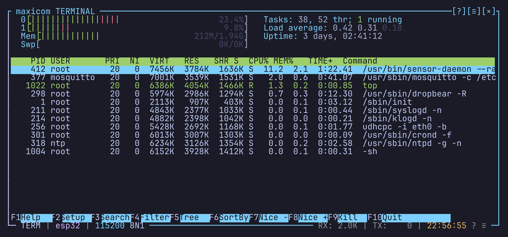

# Terminal mode

Terminal mode is a terminal emulator (VT100 / xterm, through the `vt100`
crate). The device's colors, cursor moves and full-screen programs (vim,
less, top, menuconfig) show as they would in a local terminal.

Every key goes to the device as you type it. Enter sends CR, and the arrows
and function keys send their escape sequences, in the cursor key mode the
program asked for.

Terminal mode is the default (`mode = "terminal"`). `Ctrl-a m` switches to
line mode and back.



## Screen size

The emulated screen has a size of its own, in rows and columns, which can
differ from the view: it's the size a program on the device draws for.

The device doesn't learn this size by itself, because a serial line has no
resize signal (see [Serial shells](#serial-shells) for how to tell it). So
changing it only changes what maxicom can show, and an automatic resize
never loses data.

The default, `grow_only`, suits most uses: the screen follows the window
when it grows, and keeps its content when it shrinks.

### Dimension mode

`dimension_mode` in `[terminal_mode]` decides how the screen is sized. `S`
in the settings popup cycles it.

| Mode | Size |
|---|---|
| `grow_only` (default) | Grows with the view, never shrinks. When the window gets smaller, the view follows the cursor. |
| `match_view` | The view's size, but never smaller than the content below the cursor or the widest row |
| `fixed_cols` | The view's rows, but never fewer than the content below the cursor; `cols` columns |
| `fixed` | `rows` x `cols` |

`rows` and `cols` in `[terminal_mode]` (default `24` x `80`) give the size
of `fixed`, and the columns of `fixed_cols`. They are read at startup.

### Setting the size by hand

`Ctrl-a W` (or Terminal size in the right-click menu) opens a popup with the
rows and the columns. Type a number, or step it by one with Left / Right.
Enter applies it. A size set this way applies exactly as asked.

`Ctrl-a E` gives the emulated screen the view's size at once.

### A screen wider than the view

You pan sideways with `Ctrl-a Left` / `Ctrl-a Right`, or with the status
bar's pan arrows (click them or use the wheel over them).

The view around the emulated screen is filled with `empty_fill_char`
(default `░`), colored by `term_outside` in the theme's `[terminal]`.

## Scrollback

`history_size` in `[terminal_mode]` (default `2500`) sets how many lines are
kept above the screen. It is read at startup.

The scrollback is maxicom's biggest use of memory: about
`history_size x cols x 32` bytes. 2500 lines of 80 columns take 6.4 MB; of
250 columns, 20 MB.

What the device sends never moves a view you scrolled up, so you can read
in peace. What you send (a key in terminal mode, a line in line mode) brings
the view back to the live screen. See
[Copy mode and mouse](copy-mode-and-mouse.md#scrolling) for the keys.

## Timestamps

`Ctrl-a t` adds a column on the left with the time each row was written, in
`timestamp_format`, followed by a `│`. Line mode shares the setting.

## Cursor

While maxicom's window doesn't have the focus, the cursor is drawn as
`unfocused_cursor_glyph` (`█`).

## Answering the device's queries

Programs on the device ask their terminal questions, as they would any
terminal: where the cursor is (that's how `resize` learns the size), the
screen size, the terminal's identity, the state of its modes. With
`answer_queries` in `[terminal_mode]` (default `true`), maxicom answers
them. `A` in the settings popup toggles it.

- Only live data in terminal mode gets an answer, never a restored session
  or a replay.
- Questions about colors, the title and the clipboard are never answered.

| Setting | Default | Does |
|---|---|---|
| `answer_groups` | all | Which queries to answer: `status`, `identity`, `size`, `modes` |
| `answerback` | empty | The text sent back on ENQ (`0x05`). Empty sends nothing, because `0x05` also shows up in binary data. |

## Serial shells

Over ssh or in a local terminal, a shell learns its size from the terminal,
and again on each resize (`SIGWINCH`). A serial line carries bytes only. The
device's tty keeps the size its getty set, often `0 x 0` or `24 x 80`, and
never hears about your window.

As a result, programs wrap long lines at the wrong column, and full-screen
ones (vim, less, top, menuconfig) draw at the wrong size.

### Fixing the size with `resize`

maxicom never types a command into the device by itself. Instead, the device
can fix its own size with `resize`:

1. `resize` moves the cursor to the bottom right corner.
2. It asks the terminal where the cursor is.
3. maxicom answers with the emulator's size (where its lines wrap, which
   `dimension_mode` decides).
4. `resize` sets the tty to that size.

`resize` comes with BusyBox, on most embedded Linux boards, and with xterm
(the `xterm` or `x11-utils` package on desktop distributions). It also
prints the matching `COLUMNS` and `LINES` assignments, so
`eval "$(resize)"` updates the current shell's variables too. BusyBox prints
them only when built with `FEATURE_RESIZE_PRINT`.

### Running it automatically

To fix the size at login and after each command, on serial ttys only, add
this to the device's `~/.zshrc`:

```zsh
if [[ $TTY == /dev/tty(S|AMA|USB|ACM|mxc|GS)* ]] &&
   (( $+commands[resize] )); then
  _serial_resize() { eval "$(resize)" }
  precmd_functions+=(_serial_resize)
fi
```

For bash, in `~/.bashrc`, use `PROMPT_COMMAND='eval "$(resize)"'` under the
same kind of `tty` test.

Each run costs a round trip on the line, a few bytes each way. On a very
slow link, call `_serial_resize` once instead of the `precmd_functions`
line, to fix the size at login only.

### Sending the size by hand

Alt-r sends `stty rows R cols C; export LINES=R COLUMNS=C` with the
emulator's size, the same size `resize` would get. In line mode, Alt-r sends
the columns only.

Without `answer_queries`, or on a device without `resize`, the size stays
wrong until you press Alt-r.
