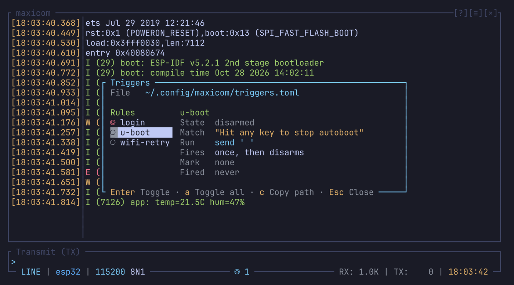

# Triggers

A trigger runs a command line as soon as a given text comes in. Use one to
stop U-Boot's autoboot with a space when it prints
`Hit any key to stop autoboot`, or to answer a login prompt with a user
name.

## The file

Triggers live in `triggers.toml`, one table per trigger, named by its table.
The default file has these three, disarmed:

```toml
[u-boot]
match = "Hit any key to stop autoboot"
run = "send ' '"

[login]
match = "login: "
run = 'send root\r'
rearm = true

[panic]
match = "Kernel panic"
run = 'notify error "the board panicked"'
rearm = true
silent = true
```

| Field | Means |
| --- | --- |
| `match` | The text to wait for. It takes the escapes of the command line: `'\x1b[7mBoot menu'`. |
| `run` | The [command line](command-line.md) to run. It runs beside your own lines, not behind them, see [Waiting and stopping](command-line.md#waiting-and-stopping) |
| `rearm` | `true` keeps the trigger armed after it fires |
| `armed` | `true` arms it at startup |
| `silent` | `true` fires it without its notice, see [Raising a notification](#raising-a-notification) |
| `mark` | A [mark](marks.md) letter, `a` to `z`, put on the line the text came in on, see [Marking the line](#marking-the-line) |

`triggers_path` in `config.toml` points to another file.

`run` can't hold a command that needs you there: one that opens a popup or a
mode (`help`, `settings`, `record`, `search`, copy mode...), or `mark` and
`jump-mark` without their letter, which would take your next key. It stops
the trigger's line with an error saying so. `marks`, `triggers` and
`notifications` are fine: they open no popup there, see
[Popups that answer](command-line.md#popups-that-answer).

### Raising a notification

`run` can also just tell you, with `notify`, without sending anything to the
device. The default file's `panic` trigger does, each time with `rearm`:

```toml
[panic]
match = "Kernel panic"
run = 'notify error "the board panicked"'
rearm = true
silent = true
```

`silent = true` leaves the trigger's own notice out, so the error is the only
notification. Arm it with `Ctrl-a T`, `trigger on panic`, or `armed = true`.

### Marking the line

`mark = "c"` puts mark `c` on the line the text came in on, so you can go
back to it later: `Ctrl-a '` then `c`, or `jump-mark c`. Each time the trigger
fires, the mark moves to the new line, so with `rearm` it's always the last
one.

```toml
[panic]
match = "Kernel panic"
run = 'notify error "the board panicked"'
mark = "c"
rearm = true
silent = true
```

The mark goes on the line where the text ends, even when more lines came in
the same read. A line still arriving gets it too: the
[marks popup](marks.md#the-marks-popup) lists it once the line is complete.
Both views get the mark when both receive the data, so it's there in line
mode and in terminal mode.

Running `mark c` from `run` isn't the same: it marks where the `mark`
command does, the last complete line, which may already be a later one.

## How matching works

`match` is searched in the received bytes as they arrive, not in whole
lines. This matters for U-Boot, which redraws its countdown on the same
line. A match still works when the text is split across two reads.

Only live bytes fire a trigger: never a replay, a restored session, or what
came in while the restore question was open.

## Armed and disarmed

A trigger fires only while it's armed, and only once: it disarms right
after, so the next boot goes on normally. `rearm = true` keeps it armed.

Triggers start disarmed unless they have `armed = true`.

When one fires, a notice says so, `Trigger u-boot: send ' '`, unless it has
`silent = true`.

## Counting

Each trigger counts how many times it fired, silent ones too. The
[trigger browser](#the-trigger-browser) shows the count at the end of its
row, and on the side as `Fired`.

The counts keep going when the link reconnects, on an attach, and when the
file or a profile is loaded again. They start again from zero when you
switch to another device. `trigger reset` sets them back to zero, or
`trigger reset <name>` one of them.

## The trigger browser

`Ctrl-a T` (or Triggers in the right-click menu) lists the triggers with
their state, `◎` armed and `○` disarmed, and how many times each fired. The
selected trigger's rule shows on the side, with its mark and its count.



On top of the [popup keys](popups.md):

| Key | Does |
| --- | --- |
| Enter, Tab, Space, a click | Toggle the selected trigger |
| `l`, Right | Arm it |
| `h`, Left | Disarm it |
| `a` | Toggle them all: armed when none is, else all disarmed |
| `c` | Copy the file's path |

## Other ways to arm them

| Key or command | Does |
| --- | --- |
| `Ctrl-a U` | Toggles `u-boot` |
| `toggle-triggers` | Toggles them all (no key by default) |
| `trigger on\|off\|toggle [name]` | Arms, disarms or toggles all, or the one named |
| `trigger reset [name]` | Sets the counts back to zero, or the one named's |

Since `trigger` is a command, one key can arm a trigger and reset the board:

```text
trigger on u-boot; dtr off; rts on; rts off
```

## In the status bar

`◎ 2` shows while two triggers are armed; a click opens the browser.

In your own [status bar](status-bar.md) template:

- `{trigger_count}` is how many are armed;
- `{trigger_names}` their names (the first one and how many more when the
  bar is short);
- `armed` is the condition.

## Errors and reloads

A rule that doesn't parse (an empty `match`, an unknown command, a misspelt
field) stops the file from loading, naming the rule. On a reload, the
running triggers stay.

A successful reload applies the file, each trigger armed or not as it says.
