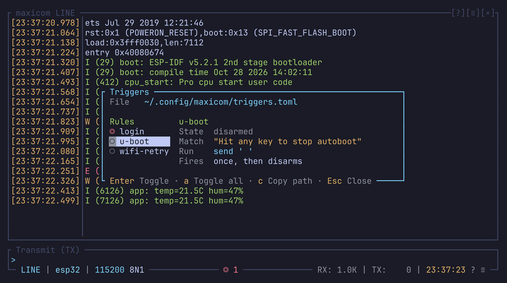

# Triggers

A trigger runs a command line as soon as a given text comes in. Use one to
stop U-Boot's autoboot with a space when it prints
`Hit any key to stop autoboot`, or to answer a login prompt with a user
name.

## The file

Triggers live in `triggers.toml`, one table per trigger, named by its table.
The default file has these two, disarmed:

```toml
[u-boot]
match = "Hit any key to stop autoboot"
run = "send ' '"

[login]
match = "login: "
run = 'send root\r'
rearm = true
```

| Field | Means |
| --- | --- |
| `match` | The text to wait for. It takes the escapes of the command line: `'\x1b[7mBoot menu'`. |
| `run` | The [command line](command-line.md) to run, as if typed, after any line still waiting |
| `rearm` | `true` keeps the trigger armed after it fires |
| `armed` | `true` arms it at startup |

`triggers_path` in `config.toml` points to another file.

## How matching works

`match` is searched in the received bytes as they arrive, not in whole
lines. This matters for U-Boot, which redraws its countdown on the same
line. A match still works when the text is split across two reads.

Only live bytes fire a trigger: never a replay, a restored session, or what
came in while the restore question was open.

## Armed and disarmed

A trigger fires only while it's armed, and only once: it disarms right
after, so the next boot goes on normally. `rearm = true` keeps it armed.

Triggers start disarmed unless they have `armed = true`.

When one fires, a notice says so.

## The trigger browser

`Ctrl-a T` (or Triggers in the right-click menu) lists the triggers with
their state, `◎` armed and `○` disarmed. The selected trigger's rule shows
on the side.



On top of the [popup keys](popups.md):

| Key | Does |
| --- | --- |
| Enter, Tab, Space, a click | Toggle the selected trigger |
| `l`, Right | Arm it |
| `h`, Left | Disarm it |
| `a` | Toggle them all: armed when none is, else all disarmed |
| `c` | Copy the file's path |

## Other ways to arm them

| Key or command | Does |
| --- | --- |
| `Ctrl-a U` | Toggles `u-boot` |
| `toggle-triggers` | Toggles them all (no key by default) |
| `trigger on\|off\|toggle [name]` | Arms, disarms or toggles all, or the one named |

Since `trigger` is a command, one key can arm a trigger and reset the board:

```text
trigger on u-boot; dtr off; rts on; rts off
```

## In the status bar

`◎ 2` shows while two triggers are armed; a click opens the browser.

In your own [status bar](status-bar.md) template:

- `{trigger_count}` is how many are armed;
- `{trigger_names}` their names (the first one and how many more when the
  bar is short);
- `armed` is the condition.

## Errors and reloads

A rule that doesn't parse (an empty `match`, an unknown command, a misspelt
field) stops the file from loading, naming the rule. On a reload, the
running triggers stay.

A successful reload applies the file, each trigger armed or not as it says.
